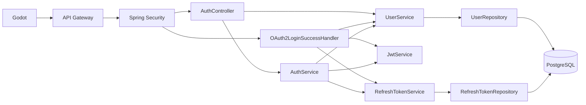

# Arquitectura y responsabilidades

## Componentes reales

| Componente | Responsabilidad y colaboración |
| --- | --- |
| [`AuthServiceApplication`](../src/main/kotlin/com/pixelchiss/auth/AuthServiceApplication.kt) | Arranca Spring Boot y el escaneo de componentes de `com.pixelchiss.auth`. Se preserva su cambio local anterior. |
| [`AuthController`](../src/main/kotlin/com/pixelchiss/auth/controller/AuthController.kt) | Mantiene rutas, anotaciones OpenAPI, cuerpos DTO y respuestas. Extrae el id del principal `Jwt`; delega refresh/logout a `AuthService` y perfiles a `UserService`. |
| [`AuthService`](../src/main/kotlin/com/pixelchiss/auth/service/AuthService.kt) | Coordina validación de refresh, búsqueda del usuario y emisión de un nuevo access token. Delega logout a `RefreshTokenService`. Conserva los errores 401 de refresh. |
| [`UserService`](../src/main/kotlin/com/pixelchiss/auth/service/UserService.kt) | Busca/crea usuarios para OAuth, consulta perfiles, valida y guarda el displayName. Centraliza la consulta de perfil con error 404 y su conversión a `UserProfileResponse`. |
| [`RefreshTokenService`](../src/main/kotlin/com/pixelchiss/auth/service/RefreshTokenService.kt) | Crea UUID de 30 días, verifica existencia/revocación/expiración y revoca por token. No rota, elimina ni invalida JWT. |
| [`JwtService`](../src/main/kotlin/com/pixelchiss/auth/security/JwtService.kt) | Carga perezosamente una clave privada RSA PKCS#8 PEM y emite JWT de 15 minutos con JJWT. No verifica tokens entrantes. |
| [`JwtAuthenticationConverter`](../src/main/kotlin/com/pixelchiss/auth/security/JwtAuthenticationConverter.kt) | Adapta el JWT validado a `JwtAuthenticationToken` sin authorities. El nombre del principal es su subject. |
| [`ClientLoginParamsFilter`](../src/main/kotlin/com/pixelchiss/auth/security/ClientLoginParamsFilter.kt) | Valida `client_state`/`client_port` en el inicio OAuth y los guarda en la sesión HTTP. No valida el state OAuth ni realiza PKCE. |
| [`OAuth2LoginSuccessHandler`](../src/main/kotlin/com/pixelchiss/auth/security/OAuth2LoginSuccessHandler.kt) | Recibe una autenticación Google exitosa; busca/crea usuario, emite tokens, invalida sesión y redirige al callback loopback de Godot. Sus pasos son funciones privadas dentro del mismo componente. |
| [`SecurityConfig`](../src/main/kotlin/com/pixelchiss/auth/security/SecurityConfig.kt) | Construye la cadena de filtros, permisos públicos, OAuth login y resource server JWT. No se modifica. |
| [`TestController`](../src/main/kotlin/com/pixelchiss/auth/controller/TestController.kt) | Conserva `GET /api/test/protected`, que responde con mensaje e identidad autenticada. |
| [`OpenApiConfig`](../src/main/kotlin/com/pixelchiss/auth/config/OpenApiConfig.kt) | Metadatos de la documentación API. Las operaciones se describen en el controlador. |
| [`UserRepository`](../src/main/kotlin/com/pixelchiss/auth/repository/UserRepository.kt) | `JpaRepository<User, Long>`; búsquedas por id, Google id y email. |
| [`RefreshTokenRepository`](../src/main/kotlin/com/pixelchiss/auth/repository/RefreshTokenRepository.kt) | `JpaRepository<RefreshToken, Long>`; búsqueda por token. |

Se usa composición e inyección por constructor. Spring Data ya ofrece los
contratos de repositorio; no se crean interfaces sin otra implementación o una
necesidad concreta. Los servicios siguen siendo componentes Spring sencillos,
sin introducir una arquitectura de puertos/adaptadores completa.

## Persistencia e Hibernate

[`User`](../src/main/kotlin/com/pixelchiss/auth/entity/User.kt) mapea `users`:
id `IDENTITY`, `googleId` y `email` únicos/no nulos, `displayName` mutable/no nulo
y `createdAt` inicializado con `Instant.now()`. El nombre del jugador se modifica
sobre la entidad encontrada y se persiste mediante `save`; la respuesta utiliza
la entidad devuelta por el repositorio.

[`RefreshToken`](../src/main/kotlin/com/pixelchiss/auth/entity/RefreshToken.kt)
mapea `refresh_tokens`: id `IDENTITY`, token único/no nulo, `userId`, `expiresAt`
y `revoked` no nulos. `userId` es un `Long`, no una relación JPA ni una clave
foránea declarada en la entidad. Por ello puede encontrarse un refresh cuyo
usuario no existe: refresh responde 401 en ese caso.

No se cambian entidades, consultas, columnas, índices ni configuración.
[`application.yaml`](../src/main/resources/application.yaml) mantiene PostgreSQL
mediante `DB_HOST`, `DB_PORT`, `DB_NAME`, `DB_USERNAME`, `DB_PASSWORD` y
`spring.jpa.hibernate.ddl-auto: update`. No se agregan `@Transactional` de
producción ni se cambian los límites de las operaciones de repositorio.

Las pruebas usan PostgreSQL real independiente, `flush` y `clear` para verificar
lecturas desde la base en lugar de confiar sólo en objetos gestionados por JPA.
