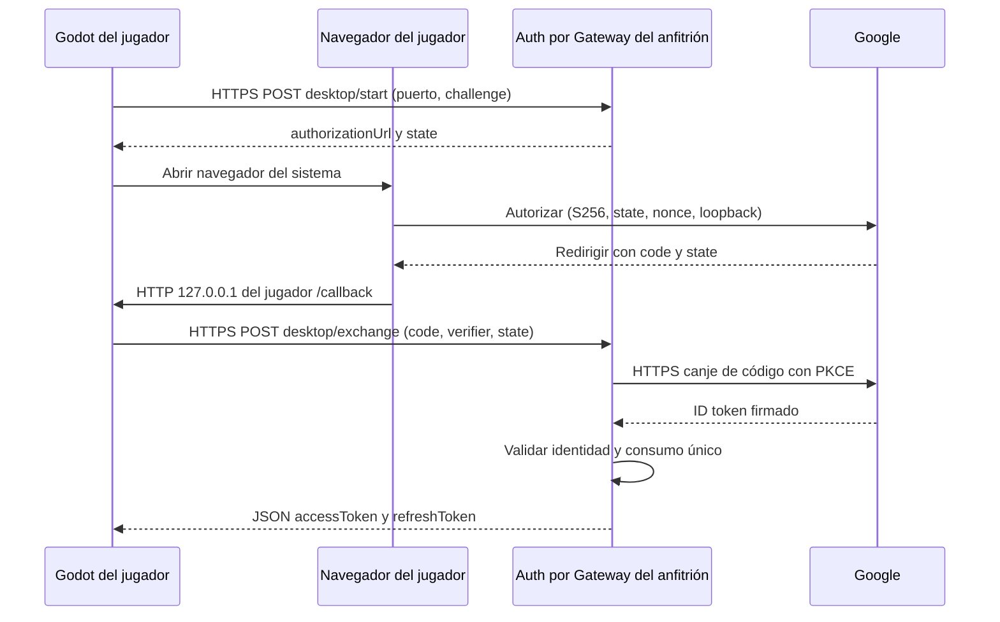

# Integración Godot: conexión local y LAN

Esta guía es el contrato para el equipo del cliente **Godot nativo de escritorio** en Windows/Linux. No se modificó ni ejecutó un proyecto Godot. El servidor conserva el motor de la baseline `5464aa22c62ce0a816612d0939ec778528f2aaf8`. El computador que ejecuta Docker es el anfitrión del backend; `host_id` de una sala identifica al jugador que administra esa sala. Pueden ser personas distintas.

## A. Selección de conexión

Ofrecer «Jugar localmente» y «Conectarse a servidor LAN».

- Local: usar `http://127.0.0.1:8080`, sin pedir IP. El backend debe estar iniciado en ese computador. No es un motor offline.
- LAN: solicitar IPv4 privada del anfitrión, puerto HTTPS (predeterminado 8443) y el certificado público `ca.crt` del anfitrión, verificado por un canal de confianza. Construir `https://<dirección>:<puerto>`. No aceptar HTTP LAN como alternativa ante errores TLS.
- El anfitrión puede jugar por su conexión local mientras el mismo Gateway atiende LAN por HTTPS. También puede usar su dirección LAN con TLS.
- Con la CA común del equipo ya configurada y certificados firmados en los anfitriones, al cambiar de anfitrión basta cambiar la dirección (y el puerto si se personalizó) y autenticar de nuevo. No requiere otro ejecutable ni cambiar OAuth en Godot. Si se eligieron CAs independientes, su importación inicial adicional es necesaria por seguridad. Nunca enviar el refresh del anfitrión anterior al nuevo. Los usuarios, salas y partidas pertenecen a la persistencia de cada backend.

## B. Configuración

Crear, por ejemplo, `ConnectionConfig.gd` (Autoload) con modo, dirección y puerto. Usar `ConfigFile` en `user://connection.cfg` para recordar opcionalmente esos datos y la CA pública elegida. No guardar tokens ni verificadores PKCE allí. Normalizar y validar una dirección literal antes de construir la URL; no concatenar una URL libre con usuario, contraseña, fragmento o rutas arbitrarias.

| Modo | Base REST | WebSocket |
|---|---|---|
| Local | `http://127.0.0.1:8080` | `ws://127.0.0.1:8080/api/game/ws` |
| LAN | `https://<IPv4 privada>:8443` | `wss://<IPv4 privada>:8443/api/game/ws` |

El puerto es configurable; todos los endpoints se construyen a partir de una sola base. «Volver a local» restaura host loopback, HTTP y puerto 8080. Si el anfitrión personalizó GATEWAY_PORT, permitir ajustar el puerto local sin pedir una IP.

El anfitrión puede preparar su red actual con `lan.py start --auto`; esta automatización no cambia endpoints ni OAuth. Cuando cambia su Wi-Fi/IP, comunica las URLs nuevas que imprime la herramienta y los jugadores actualizan la dirección en Godot. No hay descubrimiento automático del anfitrión en el cliente. La CA se conserva: no aceptar otra CA automáticamente ni desactivar la comprobación de IP. Las conexiones WebSocket anteriores pueden cortarse; reconectar por la nueva dirección y sincronizar antes de habilitar acciones. Para la misma instancia/persistencia se puede recuperar una sesión todavía válida; al pasar a otro backend independiente no reutilizar sus credenciales. El [manual](MANUAL_SERVIDOR_LAN.md#inicio-automático-y-cambios-de-wi-fi) distingue CA individual, firma del administrador y aprobaciones de mantenimiento.

Para LAN cargar la CA pública en `X509Certificate` y usar `TLSOptions.client(ca)` tanto en `HTTPRequest.set_tls_options(...)` como en `WebSocketPeer.connect_to_url(url, tls_options)`. Conservar verificación de nombre/IP del certificado. **No usar `client_unsafe`, ignorar errores TLS ni aceptar automáticamente una CA recibida por la propia conexión no verificada.** Comparar su huella SHA256 del certificado DER con el anfitrión por un canal autenticado. Para mostrar la misma huella que lan.py, decodificar a DER el bloque PEM de la CA y calcular SHA256; el hash del texto PEM completo es distinto. No distribuir `server.p12`, `ca.p12` o `lan.env`. El navegador de Google se conecta a Google con su confianza normal; para este flujo de escritorio no necesita confiar en una CA privada del backend.

Referencias de API: [HTTPRequest](https://docs.godotengine.org/en/stable/classes/class_httprequest.html), [WebSocketPeer](https://docs.godotengine.org/en/stable/classes/class_websocketpeer.html), [TLSOptions](https://docs.godotengine.org/en/stable/classes/class_tlsoptions.html). La exportación web/móvil requiere un diseño OAuth distinto; no se acredita con este flujo loopback de escritorio.

## C. Comprobación de conectividad

Antes del login consultar `GET <base>/actuator/health`. Respuesta pública mínima: `{"status":"UP"}`. Comprueba Gateway, no promete que todos los servicios descubiertos estén ya listos. No requiere JWT ni devuelve credenciales. No consultar Eureka o bases de datos desde Godot.

Configurar timeout HTTP de 5–10 segundos y plazo propio de conexión WebSocket. Mostrar mensajes distintos para dirección/puerto inválidos, conexión rechazada, timeout, certificado no confiable, IP distinta al SAN, 401, 403 y 500/502/503 transitorios de descubrimiento tras arrancar. No bloquear el hilo principal. Reintentar disponibilidad con backoff (por ejemplo 1, 2, 4, 8 segundos, máximo configurable y botón cancelar). No sustituir HTTPS por HTTP ni desactivar JWT para recuperarse.

Una vez disponible, verificar la sesión con `/api/auth/me`. Durante arranque puede ser necesario esperar propagación Eureka/Gateway aun cuando health sea UP. Reintentar lecturas; para acciones con efecto conservar las reglas de idempotencia descritas abajo.

## D. Autenticación

### Flujo recomendado: Google Desktop + PKCE, válido para local y LAN

El administrador del proyecto Google debe crear un cliente OAuth de tipo **Desktop app**, configurar el consentimiento/usuarios de prueba y entregar su client ID a cada anfitrión. No usar el ID del cliente Web existente como si fuera Desktop. Configurar `GOOGLE_DESKTOP_CLIENT_ID` en el backend; si Google requiere el secreto de ese cliente, configurarlo solo en `GOOGLE_DESKTOP_CLIENT_SECRET` del anfitrión. Godot no necesita secretos OAuth.

1. Godot genera un `codeVerifier` criptográficamente aleatorio de 43–128 caracteres permitidos por PKCE. Recomendación: 32 bytes de `Crypto.generate_random_bytes`, Base64URL sin `=`. Calcula `codeChallenge = BASE64URL(SHA256(ASCII(codeVerifier)))`, sin padding (43 caracteres). Un verificador nuevo por intento.
2. Abrir un listener HTTP **solo en `127.0.0.1` del computador del jugador**, en puerto libre 1024–65535, antes de abrir el navegador. No escuchar callbacks en `0.0.0.0` ni en la IP del anfitrión.
3. Enviar a Auth por Gateway:

   ```http
   POST /api/auth/desktop/start
   Content-Type: application/json

   {"clientPort":45678,"codeChallenge":"<S256 de 43 caracteres>"}
   ```

   Respuesta 200, `Cache-Control: no-store`:

   ```json
   {"authorizationUrl":"https://accounts.google.com/o/oauth2/v2/auth?<parámetros>","state":"<aleatorio>","expiresAt":"<fecha UTC ISO-8601>"}
   ```

   Es un ejemplo de estructura: los marcadores no son valores válidos para enviar. Guardar el state y verifier en memoria, asociados a ese servidor/intento. Un 503 puede indicar Auth todavía no disponible o Desktop sin configurar; si persiste, el anfitrión debe revisar su configuración. No inventar un login alternativo ni omitir validaciones.
4. Abrir `authorizationUrl` en el **navegador del sistema** (`OS.shell_open`), no en un navegador embebido. La URL incluye client ID público, S256, state y nonce; no contiene tokens ni el verifier.
5. Google redirige al **jugador**, a `http://127.0.0.1:45678/callback?code=...&state=...`. Ese loopback no es el del anfitrión Docker. Godot valida path y coincidencia exacta del state antes de aceptar. Si Google devuelve `error`, cancelar limpiamente. No registrar la URL completa. Mostrar una página mínima sin recursos externos, `Cache-Control: no-store` y `Referrer-Policy: no-referrer`; cerrar el listener tras un callback válido o al cancelar/vencer.
6. Godot envía el código a su backend seleccionado, siempre por HTTPS en LAN:

   ```http
   POST /api/auth/desktop/exchange
   Content-Type: application/json

   {"state":"<state del inicio>","code":"<código Google>","codeVerifier":"<verificador original>"}
   ```

   Auth deriva el redirect del puerto guardado (no acepta un callback arbitrario), comprueba PKCE/TTL/uso único, intercambia con Google y valida firma del ID token, emisor, audiencia Desktop, expiración, nonce y correo verificado. El intento dura cinco minutos, sobrevive al reinicio y solo puede consumirse una vez. Un fallo del proveedor después de consumir requiere empezar de nuevo. No repetir un canje ambiguo como si fuera una renovación de sesión.
7. Respuesta 200 exclusivamente JSON:

   ```json
   {"accessToken":"<JWT PixelChiss>","refreshToken":"<refresh PixelChiss>"}
   ```

   No son tokens Google. No ponerlos en URLs, logs, capturas o archivos de configuración. Mantener access token en memoria. Para recordar refresh usar un almacén de credenciales del sistema operativo; si el cliente no dispone de uno, conservarlo solo en memoria.
8. Usar `Authorization: Bearer <accessToken>` en REST. `GET /api/auth/me` devuelve `id`, `email`, `displayName`, `createdAt`; convertir el id al identificador textual usado por Lobby/Game.
9. Renovar mediante `POST /api/refresh`, cuerpo `{"refreshToken":"..."}`; respuesta `{"accessToken":"..."}`. La validez actual del access token es 15 minutos. Refresh mantiene las reglas anteriores (30 días, revocable).
10. Cerrar sesión mediante `POST /api/logout`, cuerpo `{"refreshToken":"..."}`; respuesta `{"message":"Sesión cerrada correctamente"}`. Cerrar sockets y borrar credenciales locales. Logout revoca ese refresh; los JWT emitidos conservan su expiración previa.

Serializar la renovación: si varias peticiones reciben 401 a la vez, un solo componente renueva y comparte el nuevo access token. Si el refresh falla con 401, borrar la sesión y pedir login; no crear un bucle de renovación. No reenviar automáticamente acciones de juego con requestId nuevo tras un error de red. Al cambiar servidor, cancelar callbacks/canjes pendientes y separar cualquier credencial recordada por servidor; no enviar la sesión del anfitrión anterior al nuevo.

El retorno de Google y el canje pertenecen a conexiones distintas:



Errores: 400 por parámetros inválidos; 401 por state/código/verificador/expiración/reutilización o validación Google fallida; 503 si Desktop no está configurado. Tratar errores HTTP como errores, no como una sesión. El servidor no devuelve los cuerpos de error del proveedor que pudieran contener datos sensibles.

### Compatibilidad del login web local anterior

Se conservan `/oauth2/authorization/google` y `/login/oauth2/code/google`, el cliente Google Web y su PKCE gestionado por Spring. Es un flujo local cuando el redirect registrado apunta al backend loopback del mismo computador. **No sirve como atajo LAN cambiando ese redirect por una IP privada. El conector TLS LAN rechaza las rutas del login Web con 400 y exige el flujo Desktop; se conservan en HTTP loopback.**

Para seguir usándolo, Godot debe añadir `client_challenge=<S256 propio>` al inicio junto a `client_state` y `client_port`. Tras el éxito recibe en su listener `?code=<handoff de PixelChiss>&state=...`, nunca access/refresh tokens. Validar client_state y canjear el handoff en `POST /api/auth/login/exchange` con `{"code":"...","codeVerifier":"..."}`. Caduca en 60 segundos y es de un solo uso. Un callback sin challenge válido falla cerrado con 400 y no emite tokens. Las versiones antiguas de Godot que esperaban tokens en la URL deben actualizarse; conservar ese retorno inseguro contradice los requisitos LAN. El state OAuth de Spring y el client_state de Godot siguen siendo distintos.

Referencia del flujo Desktop/loopback/PKCE: [Google OAuth para escritorio](https://developers.google.com/identity/protocols/oauth2/native-app). No se ha completado una autorización real de una cuenta Google en esta revisión; la prueba manual con las credenciales del equipo es obligatoria antes de dar por validado el login de usuario final.

## E. REST y WebSocket

Todas las rutas siguientes son públicas del **mismo Gateway**. No usar direcciones Docker, 8081, 8083, 8084, Redis o Eureka desde el cliente.

| Método y ruta | Cuerpo / uso | Resultado principal |
|---|---|---|
| GET `/actuator/health` | Sin JWT | Estado mínimo de Gateway |
| POST `/api/auth/desktop/start` | clientPort, codeChallenge | authorizationUrl, state, expiresAt |
| POST `/api/auth/desktop/exchange` | state, code, codeVerifier | accessToken, refreshToken |
| POST `/api/auth/login/exchange` | code, codeVerifier | Canje del retorno web local |
| POST `/api/refresh`, `/api/logout` | refreshToken | Renovación / revocación |
| GET `/api/auth/me` | Bearer | Perfil |
| PUT `/api/auth/me/display-name` | `{"displayName":"Ana_1"}` | Perfil actualizado |
| POST `/api/lobbies` | Bearer, sin cuerpo | 201, sala |
| GET `/api/lobbies/maps` | Bearer | Mapas `classic`, `science` |
| GET `/api/lobbies/{code}` | Bearer | Sala y versión; solo miembros |
| POST `/api/lobbies/{code}/join` | Bearer | Sala compartida |
| POST `/api/lobbies/{code}/leave` | Bearer | 204, sin cuerpo |
| PUT `/api/lobbies/{code}/ready` | `{"ready":true}` | Sala |
| PUT `/api/lobbies/{code}/vote` | `{"map_id":"classic"}` | Sala |
| POST `/api/lobbies/{code}/bots` | Bearer; administrador de sala | 201, sala |
| DELETE `/api/lobbies/{code}/bots/{bot_id}` | Bearer; administrador de sala | Sala |
| DELETE `/api/lobbies/{code}/players/{player_id}` | Bearer; administrador de sala | Sala |
| POST `/api/lobbies/{code}/start` | Bearer; administrador de sala | Sala STARTING/STARTED y game_id |
| GET `/api/game/board` | Bearer | Geometría v4-100 |
| GET `/api/game/games/{gameId}` | Bearer; miembro | Snapshot de partida |
| WS `/api/game/ws` | AUTH como primer frame | Estado, acciones y eventos |

Una sala contiene `code`, `host_id`, `creator_id`, `status`, `version`, `max_players`, `map_id`, `map_votes`, `players`, `banned_players`, `game_id`. Cada participante trae `user_id`, `display_name`, `role`, `ready`, `is_bot`, `voted_map_id`. No existe un WebSocket de Lobby: consultar GET sala periódicamente mientras está abierta. Errores de Lobby utilizan `{"detail":"..."}`; 403 indica permisos/miembro, 404 sala ausente, 409 estado incompatible o capacidad, 502/503 fallo de coordinación/descubrimiento. No volver a crear otra sala por un timeout de inicio: consultar la misma.

Ejemplo REST: enviar `POST <base>/api/lobbies` con `Authorization: Bearer <JWT del creador>` y sin cuerpo; guardar el `code` de la respuesta 201. El segundo jugador envía `POST <base>/api/lobbies/<code>/join` con **su propio JWT**, también sin cuerpo, y recibe la sala con ambos participantes. Después, cada cliente consulta `GET <base>/api/lobbies/<code>` y muestra los valores `display_name`, `ready`, `is_bot` y `role` recibidos. No hay una ruta pública para enumerar salas ajenas: el acceso se comparte por código. Solo cuando la respuesta indica `status="STARTED"` y trae `game_id`, abrir la partida; no derivar un gameId del código de sala.

WebSocket nativo, sin STOMP/SockJS, sin query string y sin tokens en la URL:

```json
{"type":"AUTH","token":"<accessToken>"}
{"type":"JOIN_GAME","gameId":"<game_id de Lobby>"}
```

Son frames separados; esperar `{"type":"AUTHENTICATED","playerId":"42"}` antes de JOIN_GAME. Se recibe `GAME_STATE` con `state` y `legalMoves`. La conexión nativa puede omitir Origin. No enviar un Origin arbitrario; la exportación navegador necesita allowlist explícita y tiene otro alcance OAuth.

Ejemplo de acción, solo para el actor activo y versión real:

```json
{"type":"ROLL_DICE","gameId":"game-123","requestId":"roll-1","expectedVersion":7}
```

Se recibe ACTION_ACK (`requestId`, `committedVersion`, `duplicate`, `state`) y GAME_UPDATED (`gameId`, `version`, `requestId`, `events`, `state`). Un error usa, por ejemplo, `{"type":"ERROR","code":"STALE_VERSION","message":"Resynchronize before acting","gameId":"game-123","requestId":"roll-1","version":8}`. Copiar movimientos de legalMoves, nunca inventar posiciones. Mantener las confirmaciones de animación, cartas/trivia, contadores y temporizadores del [contrato del motor](../game-service/docs/WEBSOCKET.md), que LAN no cambia.

## F. Flujo multijugador

1. Elegir conexión y comprobar Gateway/CA.
2. Autenticarse en Google desde el navegador del jugador y obtener sesión de ese backend.
3. Un jugador crea sala; otro usa su código en `/join`. El anfitrión del backend no necesita crearla.
4. Consultar GET sala para ver participantes y `version`; permitir ready/vote y administración según role.
5. El administrador de sala inicia; esperar `STARTED` y `game_id`. Si se perdió la respuesta, consultar la misma sala.
6. Abrir WS/WSS por Gateway, AUTH y JOIN_GAME.
7. Aplicar GAME_STATE y cargar tablero v4-100 por REST. No recalcular reglas en Godot.
8. Enviar acciones con requestId y expectedVersion; esperar confirmación/estado antes de construir la siguiente.
9. Procesar GAME_UPDATED por versión. ACK y evento pueden llegar en distinto orden: deduplicar por `(gameId,version)` y sincronizar ante huecos.
10. Ante interrupción, renovar JWT si corresponde, reconectar al mismo servidor, AUTH y SYNC_REQUEST con gameId. No reiniciar los temporizadores ni crear otra partida. Ante ACK perdido, solo reenviar idéntico payload/requestId para recuperar recibo.
11. Si fue retirado, terminó la partida o cambió el anfitrión del backend, mostrar el estado real y no intentar recuperar una partida en otra base de datos.

Mantener `WebSocketPeer.poll()` y manejo de cierres/ping/pong. La conexión vence con el JWT. Renovar y volver a autenticar mediante nueva conexión; no hay acción para reemplazar el token de una conexión existente.

Durante la reconexión deshabilitar acciones nuevas y mostrar el estado de conexión. Usar backoff cancelable, conservar el último gameId/versión y aplicar el snapshot autoritativo antes de habilitar la UI. La cuenta regresiva que muestra Godot es informativa: reconectar no concede otra tirada ni reinicia los 30 segundos de movimiento o los 15 de trivia. Respetar la pausa de movimiento y los identificadores de animación ya definidos en el contrato Game, sin temporizadores de reglas nuevos en el cliente.

## G. Checklist para Godot

| Obligación | Componente sugerido | Endpoint / API | Resultado y prueba |
|---|---|---|---|
| Obligatorio: selector local/LAN y puerto | ConnectionConfig.gd + menú | Base única | Local sin introducir IP; cambiar host no reutiliza sesión |
| Obligatorio: confianza CA y SAN | HttpClient.gd / GameSocket.gd | TLSOptions.client | CA válida conecta; CA ajena/IP incorrecta falla |
| Obligatorio: disponibilidad y timeout | ConnectionStatus.gd | GET health | Servidor ausente no bloquea UI; reintentos cancelables |
| Obligatorio: PKCE criptográfico | AuthSession.gd | Desktop start | Cada intento cambia verifier y challenge S256 |
| Obligatorio: callback solo loopback | OAuthLoopback.gd | 127.0.0.1:puerto/callback | Rechaza state ajeno, cancela error y cierra listener |
| Obligatorio: canje por cuerpo TLS | AuthSession.gd | Desktop exchange | No tokens en URLs/logs; código repetido no autentica |
| Obligatorio si conserva login Web local | AuthSession.gd | client_challenge + login/exchange | Consume handoff y no espera tokens en callback |
| Obligatorio: sesión, refresh/logout | AuthSession.gd | refresh/logout/me | Dos jugadores mantienen identidades independientes |
| Obligatorio: sala compartida y polling | LobbyClient.gd | Rutas Lobby | Crear/unirse/listar/ready/start en ambos mapas |
| Obligatorio: AUTH/estado/versiones | GameSocket.gd | WS/WSS | Ambos observan mismos dados, turnos y movimientos |
| Obligatorio: reconexión | GameSocket.gd | SYNC_REQUEST | Misma partida y plazos, sin acciones duplicadas |
| Ya ofrece backend: reglas/bots/EDA/SAGA | No duplicar en Godot | Contrato Game | Ejecutar regresiones visuales y de animación |
| Opcional: recordar conexión/CA pública | ConnectionConfig.gd | ConfigFile | Restablecer modo local; nunca persistir secretos aquí |
| Opcional: recordar refresh seguro | Integración SO | Keychain/credential vault | Sin almacén seguro, mantener solo en memoria |

Pruebas pendientes del equipo: login Google real con su Desktop client, Godot real, Windows como anfitrión y partida física Windows↔Linux. Clientes simulados y contenedores no sustituyen esas pruebas.
