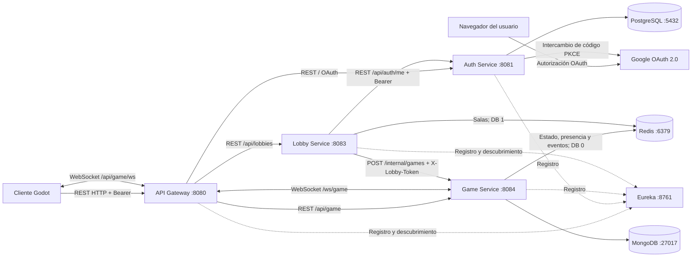

# Manual de instalación y configuración — PixelChiss Server

**Proyecto:** PixelChiss Server

**Asignatura:** Ingeniería de Software II

**Tipo de documento:** manual técnico de instalación, configuración y operación

**Fecha:** 13 de octubre de 2026

**Referencia del código inspeccionado:** rama `main`; inspección funcional y verificaciones sobre `98dd7f4`, actualización de publicación con los cambios de `68c6bbf`.

Este manual describe los componentes implementados: API Gateway, Eureka Server, Auth Service, Game Service y Lobby Service, junto con PostgreSQL, MongoDB y Redis. El cliente Godot es un consumidor externo; su código no está incluido en este repositorio. La decisión [ADR-001](decisions/ADR-001-remove-player-service.md) retiró Player Service. No existe un servicio ejecutable de Log Aggregator en el Compose actual.

Las instrucciones se basan en el código y en `infrastructure/docker/docker-compose.yml`. Algunas guías anteriores conservan afirmaciones históricas sobre Lobby o el despliegue de Game que ya no describen la implementación actual. **Lobby está implementado y dispone de imagen y servicio Docker**, incluidas operaciones de bots, votación e integración de inicio con Game. Las limitaciones puntuales se indican en los capítulos correspondientes.

**Convenciones de ejecución.** Cada bloque Bash identifica el directorio de trabajo. `PixelChissServer/` significa la raíz del clon, independientemente de dónde se encuentre en el equipo. Los comandos de administración usan el proyecto Compose `docker` y se ejecutan en `PixelChissServer/infrastructure/docker/`. Mantener ese nombre permite reutilizar la red y los volúmenes del despliegue existente. Si Docker requiere privilegios en el equipo, anteponer `sudo` a los comandos `docker`; no ejecutar Git ni la preparación del repositorio como root. Los valores entre `<...>` son marcadores que deben sustituirse, nunca credenciales reales.

**Alcance de la comprobación.** Durante la elaboración se realizaron consultas de lectura y un handshake WebSocket con token ficticio. No se reiniciaron contenedores, no se crearon salas ni partidas, no se revocaron sesiones y no se ejecutaron instrucciones de instalación sobre el equipo existente. Los pasos de instalación y arranque siguientes son instrucciones para el lector.

**Actualización antes de publicar.** El Compose incorporó posteriormente `8083:8083` para Lobby y su README. Las instrucciones siguientes reflejan esa publicación del puerto. Las verificaciones de 6.7 corresponden al despliegue anterior, donde Lobby se consultó desde Docker; no se recrearon contenedores para comprobar la publicación nueva en el anfitrión.

## Índice

1. [Instalación del API Gateway](#capitulo-1)
2. [Configuración del API Gateway en el proyecto](#capitulo-2)
3. [Creación de las bases de datos del proyecto](#capitulo-3)
4. [Configuración de las bases de datos del proyecto](#capitulo-4)
5. [Configuración de los microservicios](#capitulo-5)
   - [5.1 Auth Service](#auth-service)
   - [5.2 Game Service](#game-service)
   - [5.3 Lobby Service](#lobby-service)
   - [5.4 Eureka Server](#eureka-server)
   - [5.5 API Gateway](#api-gateway)
   - [5.6 Despliegue completo](#despliegue-completo)
6. [Documentación de los microservicios con Swagger](#capitulo-6)
   - [Tabla de operaciones REST](#operaciones-rest)
   - [WebSocket y ejemplo Godot](#websocket)
7. [Anexo A. Arquitectura del sistema](#anexo-a)
8. [Anexo B. Estructura del repositorio](#anexo-b)
9. [Anexo C. Comandos de administración](#anexo-c)
10. [Anexo D. Solución de problemas](#anexo-d)
11. [Anexo E. Lista de verificación para la sustentación](#anexo-e)

<a id="capitulo-1"></a>
## 1. Instalación del API Gateway

### 1.1 Responsabilidad y tecnologías

El API Gateway recibe las solicitudes del cliente, aplica la seguridad de entrada y las dirige al microservicio correspondiente. En PixelChiss ofrece operaciones de Auth y Lobby mediante HTTP y consultas REST y comunicación WebSocket de Game. No contiene las reglas del juego ni almacena sus partidas.

Eureka es un componente distinto: mantiene el registro de instancias y permite descubrir sus direcciones. El Gateway consulta ese registro para seleccionar destinos; Eureka no reemplaza al Gateway ni representa la entrada de la API del cliente.

| Elemento | Versión o configuración del repositorio |
|---|---|
| Java | 21, propiedad `java.version` de los cuatro POM |
| Spring Boot | 4.1.1 |
| Spring Cloud | BOM 2025.1.3 |
| Gateway | `spring-cloud-starter-gateway-server-webmvc`; la documentación del proyecto identifica WebMVC 5.0.3 |
| Maven del wrapper | 3.9.16; wrapper 3.3.4 |
| Compilación Docker JVM | `maven:3.9-eclipse-temurin-21` |
| Ejecución Docker JVM | `eclipse-temurin:21-jre` |
| Kotlin de Auth | 2.3.21 |
| Documentación Auth y Game | `springdoc-openapi-starter-webmvc-ui:3.0.2` |
| Lobby | `python:3.12-slim`, FastAPI 0.141.1, Uvicorn 0.54.0 |

Las etiquetas Docker indicadas no fijan un parche ni un digest. Las versiones de Java, Boot y las dependencias explícitas proceden de los POM; las de Python, de su Dockerfile y `requirements.txt`.

### 1.2 Requisitos y preparación del equipo

Se recomienda Ubuntu 24.04 LTS de 64 bits para reproducir la instalación. Linux Mint basado en Ubuntu puede utilizar la base Ubuntu indicada en `/etc/os-release`; Docker no ofrece soporte oficial para esa distribución derivada. El procedimiento externo de instalación se contrasta con la [documentación oficial de Docker para Ubuntu](https://docs.docker.com/engine/install/ubuntu/).

Se necesitan Git, Docker Engine, el plugin Compose, Buildx, curl, OpenSSL, un navegador y acceso a GitHub, los repositorios Maven y Python, Docker Hub y Google. **Java 21 y Maven en el anfitrión solo son necesarios para compilar o ejecutar fuera de Docker**: los Dockerfiles ya contienen sus herramientas de compilación. Python 3 se utiliza en el asistente opcional de preparación de `.env`; Python 3.12 y sus dependencias de aplicación solo son necesarios en el anfitrión si se ejecuta Lobby fuera de Docker.

En un equipo nuevo, desde cualquier directorio:

```bash
sudo apt update
sudo apt install git curl ca-certificates openssl nano python3
sudo install -m 0755 -d /etc/apt/keyrings
sudo curl -fsSL https://download.docker.com/linux/ubuntu/gpg -o /etc/apt/keyrings/docker.asc
sudo chmod a+r /etc/apt/keyrings/docker.asc
sudo tee /etc/apt/sources.list.d/docker.sources >/dev/null <<EOF
Types: deb
URIs: https://download.docker.com/linux/ubuntu
Suites: $(. /etc/os-release && echo "${UBUNTU_CODENAME:-$VERSION_CODENAME}")
Components: stable
Architectures: $(dpkg --print-architecture)
Signed-By: /etc/apt/keyrings/docker.asc
EOF
sudo apt update
sudo apt install docker-ce docker-ce-cli containerd.io docker-buildx-plugin docker-compose-plugin
sudo systemctl start docker
sudo docker run --rm hello-world
sudo docker info
docker --version
docker compose version
git --version
openssl version
```

Si ya existe Docker, comprobarlo antes de instalar paquetes y revisar posibles conflictos con la guía oficial. La salida de `hello-world` confirma su ejecución; `docker info` debe mostrar un servidor accesible. En el equipo auditado se observó Docker **29.8.1** y Compose **v5.5.0**; el repositorio no exige esas versiones concretas. Se utiliza el comando actual `docker compose`, no el ejecutable legado `docker-compose`.

Para la alternativa JVM local, en Ubuntu con ese paquete disponible:

```bash
# Cualquier directorio del anfitrión; opcional para ejecución fuera de Docker.
sudo apt install openjdk-21-jdk
java -version
```

No es necesario instalar Kotlin por separado: el plugin Maven lo incorpora. No se especifica un mínimo de RAM o disco porque el repositorio no lo establece; prever espacio para cinco imágenes y sus dependencias de compilación.

### 1.3 Obtención del repositorio

Desde el directorio donde se almacenarán los proyectos:

```bash
git clone https://github.com/Mateo-Castro06/PixelChissServer.git
cd PixelChissServer
git status --short --branch
git rev-parse --short HEAD
ls
```

Si GitHub exige acceso, utilizar una cuenta autorizada o SSH previamente configurado. No introducir tokens en la URL del clon. Deben aparecer `api-gateway/`, `eureka-server/`, `auth-service/`, `game-service/`, `lobby-service/`, `infrastructure/` y `docs/`. El árbol del anexo B distingue las fuentes de las herramientas de despliegue.

### 1.4 Preparación de configuración y claves

Completar primero las variables y claves del [apartado 5.6](#despliegue-completo). El Gateway necesita `EUREKA_URL` y `JWT_PUBLIC_KEY_PATH`, con la clave pública de Auth en `api-gateway/keys/public_key.pem`. Las claves y el archivo `.env` no vienen versionados; omitir su preparación impide un arranque reproducible.

### 1.5 Construcción y ejecución

El Dockerfile de Gateway realiza `mvn dependency:go-offline -B` y `mvn clean package -DskipTests`, copia el JAR y lo ejecuta con `java -jar app.jar`. No requiere un JAR preexistente en el anfitrión. La opción `-DskipTests` omite la ejecución de pruebas durante ese build.

```bash
# Directorio: PixelChissServer/infrastructure/docker/
docker compose -p docker config --quiet
docker compose -p docker build api-gateway
docker compose -p docker up -d eureka-server
docker compose -p docker up -d --wait --wait-timeout 180 api-gateway
docker compose -p docker ps api-gateway eureka-server
```

El Gateway puede estar saludable aunque Auth, Game o Lobby todavía no hayan arrancado; para atender sus operaciones se requiere el despliegue completo del capítulo 5. `depends_on` garantiza que Eureka haya iniciado su contenedor, pero no que ya responda HTTP.

Alternativa de compilación local:

```bash
# Directorio: PixelChissServer/api-gateway/
./mvnw -version
./mvnw clean package -DskipTests
export EUREKA_URL='http://localhost:8761/eureka/'
export JWT_PUBLIC_KEY_PATH="$(pwd)/keys/public_key.pem"
java -jar target/api-gateway-0.0.1-SNAPSHOT.jar
```

El wrapper descarga Maven si no está disponible. No iniciar el JAR en 8080 mientras el contenedor Gateway ocupe ese puerto. En una ejecución mixta, las direcciones registradas en Eureka deben ser resolubles desde el proceso local; un nombre de contenedor no es automáticamente resoluble por el anfitrión.

### 1.6 Comprobación y resultados esperados

```bash
# Cualquier directorio del anfitrión, con el despliegue activo.
curl --fail --silent --show-error http://localhost:8080/actuator/health
curl --fail --silent --show-error http://localhost:8761/ -o /dev/null -w 'Eureka HTTP %{http_code}\n'
curl --fail --silent --show-error -H 'Accept: application/json' http://localhost:8761/eureka/apps
```

Gateway debe responder HTTP 200 con `"status":"UP"`; puede incluir grupos `liveness` y `readiness`. Eureka debe responder 200 y mostrar `API-GATEWAY` registrado como `UP`, normalmente después de algunos segundos de registro y actualización de caché. Una respuesta 401 en una operación protegida sin token es un resultado de seguridad esperado, pero por sí sola no demuestra que la petición haya alcanzado su backend.

<a id="capitulo-2"></a>
## 2. Configuración del API Gateway en el proyecto

### 2.1 Archivos y descubrimiento

| Archivo desde la raíz | Función |
|---|---|
| `api-gateway/pom.xml` | Dependencias WebMVC, seguridad, WebSocket, Eureka y Actuator |
| `api-gateway/src/main/resources/application.yaml` | Puerto 8080, destinos `lb://`, predicados, reescrituras y clave JWT |
| `api-gateway/src/main/java/com/pixelchiss/gateway/security/SecurityConfig.java` | Cadena de seguridad y excepciones públicas |
| `api-gateway/src/main/java/com/pixelchiss/gateway/websocket/GameWebSocketConfig.java` | Registro del handler WebSocket y Origins |
| `api-gateway/src/main/java/com/pixelchiss/gateway/websocket/GameWebSocketProxy.java` | Descubrimiento de Game y apertura del puente |
| `api-gateway/src/main/java/com/pixelchiss/gateway/websocket/GameSocketBridge.java` | Transferencia de frames, límites, latidos y cierres |
| `api-gateway/src/main/resources/static/game-swagger.html` | HTML de Swagger público de Game |
| `infrastructure/docker/docker-compose.yml` | Imagen, variables, montaje, publicación 8080 y arranque |

Los URI `lb://AUTH-SERVICE`, `lb://GAME-SERVICE` y `lb://LOBBY-SERVICE` identifican servicios, no direcciones fijas. Eureka anuncia sus instancias y Spring Cloud LoadBalancer selecciona una. Para WebSocket, `LoadBalancerClient.choose("GAME-SERVICE")` resuelve el backend y abre `/ws/game`; la sesión conserva esa instancia hasta cerrar.

### 2.2 Convención y rutas públicas reales

La forma `/api/microservicio/funcion` se observa en `/api/auth/me` y `/api/game/board`. Lobby utiliza el plural `/api/lobbies`. Las rutas de compatibilidad `/api/refresh` y `/api/logout`, así como OAuth, son excepciones reales. No hay un prefijo global que pueda aplicarse arbitrariamente a cualquier controlador.

| Ruta pública | Método o protocolo | Microservicio destino | Ruta interna | Autenticación |
|---|---|---|---|---|
| `/api/refresh` | POST | Auth | `/api/auth/refresh` | Refresh token en JSON; no exige Bearer |
| `/api/logout` | POST | Auth | `/api/auth/logout` | Refresh token en JSON; no exige Bearer |
| `/oauth2/authorization/**` | Sin predicado Method; inicio efectivo GET | Auth | Misma ruta; proveedor `google` | Sesión OAuth; parámetros de cliente obligatorios |
| `/login/oauth2/code/**` | Sin predicado Method; callback efectivo GET | Auth | Misma ruta; proveedor `google` | Código/state y sesión OAuth |
| `/api/auth/me` | GET | Auth | Misma ruta | Bearer JWT en Gateway y Auth |
| `/api/auth/me/display-name` | PUT | Auth | Misma ruta | Bearer JWT en Gateway y Auth |
| `/api/game/board` | GET | Game | Misma ruta | Bearer JWT en ambos |
| `/api/game/games/{gameId}` | GET | Game | Misma ruta | Bearer JWT y pertenencia en Game |
| `/api/game/test/mongodb` | GET | Game | `/test/mongodb` | Bearer; diagnóstico condicionado |
| `/api/game/test/redis` | GET | Game | `/test/redis` | Bearer; diagnóstico condicionado |
| `/api/game/openapi` | GET | Game | `/v3/api-docs/public-game` | Público |
| `/api/game/swagger-ui/index.html` | GET | Gateway, con recursos de Game | `forward:/game-swagger.html` | Público por excepción específica |
| `/api/game/swagger-ui/**` | GET | Game | `/swagger-ui/**` | Público; excluye el index resuelto localmente |
| `/api/lobbies/**` | Sin predicado Method; operaciones GET, POST, PUT y DELETE | Lobby | Misma ruta, incluidas las 11 operaciones de salas | Bearer JWT en Gateway y Lobby |
| `/api/game/ws` | GET + Upgrade WebSocket | Game mediante puente Java | `/ws/game` | Handshake público; primer mensaje `AUTH` obligatorio |
| `/actuator/health` | GET | Gateway mismo | `/actuator/health` | Público; no consulta la salud de todos los backends |

`RewritePath` transforma refresh/logout, los diagnósticos, la especificación pública y los assets de Game. Las rutas de perfil, tablero, partida y Lobby conservan su path. El HTML público de Swagger se sirve mediante un forward local y carga `/api/game/openapi`; el documento usa servidor `/`, evitando duplicar `/api/game`.

**Rutas sin exposición en el Gateway:** `/internal/games`, `/api/test/protected` de Auth, Swagger/OpenAPI de Auth, `/docs`, `/redoc`, `/openapi.json` y `/health/redis` de Lobby, y la salud de Auth/Game. La ausencia de ruta no implica necesariamente 404 sin credenciales: el filtro de seguridad puede devolver primero 401. Tampoco existen rutas REST públicas para mover fichas, lanzar dados, gestionar cartas o ejecutar bots de Game; son acciones WebSocket o trabajos internos.

### 2.3 Seguridad y variables

Gateway deshabilita CSRF y verifica Bearer con `spring.security.oauth2.resourceserver.jwt.public-key-location: file:${JWT_PUBLIC_KEY_PATH}`. Permite sin Bearer la salud, refresh/logout, OAuth/login y los GET de WebSocket y documentación de Game. Los demás accesos requieren autenticación. Los backends también validan JWT; Game y Lobby aplican pertenencia y permisos propios.

| Variable/propiedad | Aplicación real |
|---|---|
| `EUREKA_URL` | Obligatoria en YAML; en Docker `http://eureka-server:8761/eureka/` |
| `JWT_PUBLIC_KEY_PATH` | Obligatoria; `/app/keys/public_key.pem` en el ejemplo Docker |
| `GATEWAY_GAME_ALLOWED_ORIGINS` | Opcional en Java; predeterminado `http://localhost:8080` |
| `gateway.game.heartbeat-millis` | Predeterminado 5000 |
| `gateway.game.pong-timeout-millis` | Predeterminado 30000 |

Compose **solo transmite las dos primeras variables al Gateway**. Agregar `GATEWAY_GAME_ALLOWED_ORIGINS` únicamente al `.env` no la introduce en ese contenedor. Para un cliente web con otro Origin hace falta una configuración de despliegue que la transmita y que coincida con `GAME_ALLOWED_ORIGINS`; este manual no modifica Compose. El cliente nativo puede omitir Origin. Cualquier query string en la URL WebSocket se rechaza con 400; no enviar el token por URL.

### 2.4 Verificación del enrutamiento

Con un access token obtenido mediante el flujo Auth, desde cualquier directorio del anfitrión:

```bash
read -r -s -p 'Access token: ' PIXELCHISS_ACCESS_TOKEN
printf '\n'
curl --fail --silent --show-error -H "Authorization: Bearer $PIXELCHISS_ACCESS_TOKEN" http://localhost:8080/api/auth/me
curl --fail --silent --show-error -H "Authorization: Bearer $PIXELCHISS_ACCESS_TOKEN" http://localhost:8080/api/game/board
curl --fail --silent --show-error -H "Authorization: Bearer $PIXELCHISS_ACCESS_TOKEN" http://localhost:8080/api/lobbies/maps
unset PIXELCHISS_ACCESS_TOKEN
```

Se esperan respectivamente un perfil, la definición de 96 casillas y el catálogo `classic`/`science`, todos con 200. Un perfil puede responder 404 si el subject no corresponde a un usuario persistido. Estos tres accesos autenticados quedan como comprobación del lector: en esta elaboración no se utilizó un token real. Sí se verificaron sus respuestas 401 sin token, Swagger público de Game y el inicio OAuth a través de Gateway.

<a id="capitulo-3"></a>
## 3. Creación de las bases de datos del proyecto

### 3.1 Infraestructura común

El Compose existente declara una red bridge `pixelchiss-network` y tres volúmenes nombrados. Con `-p docker`, se materializan como `docker_pixelchiss-network`, `docker_postgres_data`, `docker_mongodb_data` y `docker_redis_data`. No cambiar el nombre del proyecto sobre un despliegue que ya tiene datos.

| Base | Imagen real | Contenedor | Puerto anfitrión → contenedor | Volumen y destino | Consumidor |
|---|---|---|---|---|---|
| PostgreSQL | `postgres:17` | `pixelchiss-postgres` | 5432 → 5432 | `postgres_data:/var/lib/postgresql/data` | Auth |
| MongoDB | `mongo:7` | `pixelchiss-mongodb` | 27017 → 27017 | `mongodb_data:/data/db` | Game |
| Redis | `redis:8` | `pixelchiss-redis` | 6379 → 6379 | `redis_data:/data` | Game y Lobby |

Preparar `.env` conforme al capítulo 5 y ejecutar:

```bash
# Directorio: PixelChissServer/infrastructure/docker/
docker compose -p docker config --quiet
docker compose -p docker up -d --wait --wait-timeout 120 postgres mongodb redis
docker compose -p docker ps postgres mongodb redis
```

Los tres contenedores deben aparecer `healthy`. Compose incorpora healthchecks `pg_isready`, `db.adminCommand('ping')` y `redis-cli ping`, respectivamente, con intervalo de 10 segundos, timeout de 5 segundos y cinco reintentos.

### 3.2 PostgreSQL

PostgreSQL conserva los usuarios y refresh tokens de Auth. En el primer inicio de un **volumen vacío**, la imagen utiliza `POSTGRES_DB`, `POSTGRES_USER` y `POSTGRES_PASSWORD` para crear la base y el usuario. El ejemplo usa `pixelchiss` como nombre de base y usuario; la contraseña debe reemplazarse. No hay un script SQL propio de inicialización ni un montaje `docker-entrypoint-initdb.d` en este Compose.

Después, Auth crea o actualiza sus tablas mediante Hibernate `ddl-auto: update`. No se deben crear a mano tablas diferentes ni ejecutar SQL de inserción de usuarios para sustituir el login.

```bash
# Directorio: PixelChissServer/infrastructure/docker/
docker compose -p docker exec -T postgres sh -c 'pg_isready -U "$POSTGRES_USER" -d "$POSTGRES_DB"'
docker compose -p docker exec -T postgres sh -c 'psql -U "$POSTGRES_USER" -d "$POSTGRES_DB" -c "SELECT tablename FROM pg_tables WHERE schemaname = '\''public'\'' ORDER BY tablename;"'
```

Resultado: `accepting connections`. Tras iniciar Auth deben existir `users` y `refresh_tokens`; ambas se observaron en la comprobación. La consulta solo enumera tablas, sin revelar datos. Cambiar las variables de inicialización con un volumen ya usado no cambia automáticamente los usuarios o contraseñas almacenados.

### 3.3 MongoDB

MongoDB almacena el catálogo de cartas y trivia de Game. `MONGO_INITDB_DATABASE` se configura como `pixelchiss`; **la base y sus colecciones se materializan al escribir datos**. Compose no monta scripts propios ni configura autenticación MongoDB. `CatalogSeeder`, al arrancar Game, lee `game-service/src/main/resources/seed/catalog.json` y realiza upserts por `_id` con `$setOnInsert`.

Las colecciones son `game_cards` y `game_questions`. La semilla contiene cuatro cartas y ocho preguntas, distribuidas entre `classic` y `science`. No sobreescribe documentos que ya existen ni requiere que el lector ejecute una importación manual.

```bash
# Directorio: PixelChissServer/infrastructure/docker/
docker compose -p docker exec -T mongodb mongosh --quiet --eval 'db.adminCommand({ping:1})'
docker compose -p docker exec -T mongodb mongosh --quiet --eval 'db.getSiblingDB("pixelchiss").getCollectionNames()'
docker compose -p docker exec -T mongodb mongosh --quiet --eval 'JSON.stringify({cards:db.getSiblingDB("pixelchiss").game_cards.countDocuments({}),questions:db.getSiblingDB("pixelchiss").game_questions.countDocuments({})})'
```

Se espera `ok: 1`; después de iniciar Game, las dos colecciones y, en una instalación nueva con la semilla vigente, `cards:4` y `questions:8`. Los recuentos pueden aumentar si se añade catálogo. El volumen conserva esos documentos al recrear contenedores.

### 3.4 Redis

Redis proporciona el estado autoritativo de partidas, control de versiones, publicación de eventos y presencia de Game, además del almacenamiento de salas de Lobby. No requiere crear tablas ni una base mediante SQL: Game usa la base lógica 0 y Lobby usa la 1 en Compose.

```bash
# Directorio: PixelChissServer/infrastructure/docker/
docker compose -p docker exec -T redis redis-cli PING
docker compose -p docker exec -T redis redis-cli -n 0 PING
docker compose -p docker exec -T redis redis-cli -n 1 PING
docker compose -p docker exec -T redis redis-cli CONFIG GET appendonly save
```

Las tres comprobaciones deben responder `PONG`. El volumen `/data` permite conservar archivos de persistencia. Compose no define una configuración AOF propia. En el servidor auditado se observó `appendonly=no` y `save="3600 1 300 100 60 10000"`: se utilizan snapshots RDB según esos umbrales. **Esto no garantiza recuperar cada última jugada tras una caída de Redis**. No se reinició Redis para comprobar recuperación ni se modificó su configuración.

<a id="capitulo-4"></a>
## 4. Configuración de las bases de datos del proyecto

### 4.1 Variables seguras y nombres Docker

La referencia es [`infrastructure/docker/.env.example`](../infrastructure/docker/.env.example). El archivo real `.env` está ignorado por Git. Ejemplo documental, sin credenciales válidas:

```dotenv
POSTGRES_DB=pixelchiss
POSTGRES_USER=pixelchiss
POSTGRES_PASSWORD=<contraseña-local-generada>
DB_HOST=postgres
DB_PORT=5432
DB_NAME=${POSTGRES_DB}
DB_USERNAME=${POSTGRES_USER}
DB_PASSWORD=${POSTGRES_PASSWORD}
EUREKA_URL=http://eureka-server:8761/eureka/
JWT_PRIVATE_KEY_PATH=/app/keys/private_key.pem
JWT_PUBLIC_KEY_PATH=/app/keys/public_key.pem
GOOGLE_CLIENT_ID=<identificador-del-cliente-google>
GOOGLE_CLIENT_SECRET=<secreto-del-cliente-google>
MONGODB_URI=mongodb://mongodb:27017/pixelchiss
REDIS_URL=redis://redis:6379/0
GAME_ALLOWED_ORIGINS=http://localhost:8080
GAME_LOBBY_TOKEN=<credencial-privada-generada-de-al-menos-32-caracteres>
```

`LOBBY_REDIS_URL=redis://redis:6379/1` es una variable opcional **leída por Compose** aunque no aparezca en `.env.example`: su valor se transmite a Lobby como `REDIS_URL`. No cambiar el `REDIS_URL` global a la base 1 para configurar Lobby, porque también cambiaría Game.

Dentro de un contenedor, `localhost` identifica ese contenedor. Las conexiones entre servicios usan los nombres Docker `postgres`, `mongodb`, `redis`, `eureka-server`, `auth-service`, `game-service` y `lobby-service`. Docker resuelve esos nombres en la red compartida. Desde el anfitrión se utilizan los puertos publicados y `localhost`. Las bases aparecen publicadas en todas las interfaces según Compose; esta configuración corresponde al entorno de demostración y no incorpora endurecimiento de red para un servidor público.

### 4.2 PostgreSQL y Auth

`auth-service/src/main/resources/application.yaml` define:

```yaml
spring:
  datasource:
    url: jdbc:postgresql://${DB_HOST}:${DB_PORT}/${DB_NAME}
    username: ${DB_USERNAME}
    password: ${DB_PASSWORD}
  jpa:
    hibernate:
      ddl-auto: update
    show-sql: false
```

En Compose, la variable del **contenedor Auth** `DB_PASSWORD` se obtiene directamente de `${POSTGRES_PASSWORD}`. El campo `DB_PASSWORD` del ejemplo no modifica ese mapeo. `DB_NAME` y `DB_USERNAME` deben coincidir con la base y usuario inicializados en PostgreSQL.

| Capa | Implementación y datos |
|---|---|
| Entidad `User` | Tabla `users`: `id:Long`, Google id y email únicos, `displayName`, `createdAt:Instant` |
| Entidad `RefreshToken` | Tabla `refresh_tokens`: `id:Long`, `token:String` único, `userId:Long`, `expiresAt:Instant`, `revoked:Boolean` |
| Repositorios | `UserRepository` y `RefreshTokenRepository`, extensiones de `JpaRepository` |
| Servicios | `UserService`, `RefreshTokenService`, `AuthService` |
| DTOs de entrada | `RefreshTokenRequest`, `LogoutRequest`, `UpdateDisplayNameRequest` |
| DTOs de salida | `TokenResponse`, `MessageResponse`, `UserProfileResponse` |

El DTO separa el contrato HTTP de la entidad almacenada: el perfil no expone Google id ni refresh tokens. `RefreshToken.userId` es un identificador escalar, no una asociación JPA declarada. Hibernate administra el esquema con `update`; no existe aquí un procedimiento de migraciones Flyway/Liquibase.

Los refresh tokens son UUID persistidos por 30 días, sin rotación automática. Renovar produce un JWT nuevo de 15 minutos; cerrar sesión marca el refresh como revocado. No borra usuarios ni invalida inmediatamente access tokens ya emitidos.

Comprobar la conectividad con `pg_isready`, las tablas del capítulo 3, el health de Auth y sus logs. Un perfil auténtico recibido por Gateway demuestra además lectura funcional del usuario. Un 200 de salud no sustituye una prueba completa de login con Google.

### 4.3 MongoDB y Game

`game-service/src/main/resources/application.yaml` emplea `spring.mongodb.uri: ${MONGODB_URI}`, conforme a Boot 4. No debe sustituirse por una propiedad antigua de otro proyecto. `MongoGameCatalog` implementa `GameCatalog` usando `MongoTemplate`, no un repositorio `MongoRepository` generado.

| Documento | Colección | Campos del contrato persistido |
|---|---|---|
| `CardDefinition` | `game_cards` | `id`, `name`, `description`, `type`, `effectCode`, `parameters`, `conditions`, `targetRequired`, `mapId` |
| `QuestionDefinition` | `game_questions` | `id`, `mapId`, `prompt`, `options:list<String>`, `correctIndex:int` |

MongoDB guarda definiciones del catálogo; las partidas no se duplican allí. Game consulta cartas por tipo y mapa, admitiendo `mapId="*"` para cartas comunes; las preguntas se seleccionan por temática. La semilla se activa por defecto mediante `game.seed.enabled` y no sobreescribe cambios administrativos. No existe un CRUD REST público del catálogo.

Comprobar ping, nombres de colecciones, recuentos y `/actuator/health` de Game. Los diagnósticos `/test/mongodb` y `/test/redis` no se usan en las verificaciones de este manual: están deshabilitados por defecto y, si se habilitan, **escriben** datos de prueba.

### 4.4 Redis en Game y Lobby

Game utiliza `spring.data.redis.url: ${REDIS_URL}`, `StringRedisTemplate` y `RedisGameRepository`. Lobby crea `redis.asyncio.from_url(config.REDIS_URL, decode_responses=True)` en `app/core/redis.py`.

| Servicio / base lógica en Compose | Clave o mecanismo | Uso |
|---|---|---|
| Game / 0 | Hash `pixelchiss:game:state:{gameId}` | JSON del agregado y versión |
| Game / 0 | Set `pixelchiss:game:active` | Índice para temporizadores y bots |
| Game / 0 | ZSet `pixelchiss:game:presence:{gameId}:{playerId}` | Presencia por sesión, leases y reconexión |
| Game / Pub/Sub | Canal `pixelchiss:game:events` | Lotes `GAME_UPDATED` entre instancias |
| Lobby / 1 | Hash `lobby:{code}` | Anfitrión, creador, estado, versión, mapa y partida |
| Lobby / 1 | ZSet `lobby:{code}:players` | Participantes ordenados por ingreso |
| Lobby / 1 | Hashes `:names`, `:votes` | Nombres y votos por participante |
| Lobby / 1 | Sets `:ready`, `:bots`, `:banned` | Preparación, bots y expulsados |

Los scripts Lua de Game comparan la versión, confirman el agregado, actualizan el índice y publican de forma atómica. Conserva hasta 256 recibos de acciones en el agregado para responder a reintentos idénticos. El prefijo de estado puede configurarse mediante `game.redis-prefix`; el canal y las claves de presencia tienen nombres propios en el código. Los scripts corresponden a Redis standalone; el despliegue no declara Redis Cluster.

Lobby usa Lua para incorporar o retirar participantes, bots, preparación, votos, expulsiones y transiciones de inicio. Renueva un TTL de **7200 segundos** en sus datos después de cambios aplicables; consultas y operaciones sin cambio no equivalen a renovación permanente. La sala se elimina cuando ya no quedan humanos. Game no configura TTL de eliminación de partidas finalizadas.

Reiniciar únicamente Game permite releer estados, versiones, plazos e índice mientras Redis los conserve. Lobby recupera sus salas existentes dentro de su TTL. Las conexiones WebSocket deben restablecerse; los temporizadores del servidor pueden avanzar partidas durante una interrupción. Pub/Sub no guarda historial: el cliente debe solicitar `SYNC_REQUEST` ante huecos de versión. La durabilidad frente a pérdida de Redis depende de RDB/AOF, según el capítulo 3.

Comprobación desde la misma red de los microservicios:

```bash
# Directorio: PixelChissServer/infrastructure/docker/
docker compose -p docker exec -T lobby-service python - <<'PY'
import asyncio
import redis.asyncio as redis

async def main():
    for url in ("redis://redis:6379/0", "redis://redis:6379/1"):
        client = redis.from_url(url)
        print(url, await client.ping())
        await client.aclose()

asyncio.run(main())
PY
```

Se espera `True` para ambas conexiones. Son valores de ejemplo Docker sin contraseña, coherentes con este Compose.

<a id="capitulo-5"></a>
## 5. Configuración de los microservicios

<a id="auth-service"></a>
### 5.1 Auth Service

**Responsabilidad y organización.** Auth proporciona autenticación Google, emisión y renovación de tokens, cierre de sesión y perfil. Usa Kotlin 2.3.21, Boot 4.1.1 y Java 21. El paquete raíz es `com.pixelchiss.auth`: `controller`, `service`, `repository`, `entity`, `dto`, `security` y `config` separan transporte, casos de uso, persistencia, contratos y seguridad. `AuthServiceApplication` inicia la aplicación. `AuthController` delega perfiles a `UserService` y sesiones a `AuthService`; `TestController` conserva una prueba JWT directa.

**OAuth 2.0, PKCE y retorno a Godot.** El cliente abre un listener loopback y el navegador hacia `/oauth2/authorization/google?client_state=...&client_port=...`. `client_state` debe tener entre 16 y 128 caracteres de letras, dígitos, guion o guion bajo; el puerto entero debe estar entre 1024 y 65535. No existe login por contraseña en estos controladores.

Spring Security administra el `state` OAuth, la sesión HTTP, los scopes `openid`, `profile`, `email` y PKCE. El `client_state` de Godot es distinto del state OAuth. Se comprobó que la autorización generada incluye `code_challenge_method=S256`; no hay un controlador PKCE propio. Google devuelve un código a `/login/oauth2/code/google`, y el framework realiza el intercambio.

`OAuth2LoginSuccessHandler` busca o crea al usuario por Google `sub`, emite JWT y refresh y redirige a:

```text
http://127.0.0.1:{client_port}/callback?accessToken={access}&refreshToken={refresh}&state={client_state}
```

El cliente debe verificar el state y conservar sus tokens de forma privada. Ese callback devuelve credenciales: no compartir su URL ni imprimirla en informes. El login completo con Google y ese listener no se ejecutó durante esta elaboración.

**Configuración Google para el Compose vigente.** Crear un cliente OAuth apropiado en Google Cloud, habilitar la pantalla de consentimiento y, si aplica, autorizar los usuarios de prueba. Registrar exactamente **`http://localhost:8081/login/oauth2/code/google`** como URI de redirección para la demostración local: es el valor predeterminado de `OAUTH_REDIRECT_URI` y fue observado en la autorización real. La variable existe en YAML, pero Compose **no la transmite**. Cambiar solo `.env` a un callback 8080 no modifica el Auth desplegado. Una configuración futura que transmita una URI distinta requiere registrar la misma URI en Google; no se realizó aquí.

**JWT.** `JwtService` lee una clave RSA privada PKCS#8 PEM, genera `sub`, `email`, `iat` y `exp` y firma con JJWT 0.12.6. La duración es 15 minutos. El algoritmo se selecciona según la clave; para la instalación nueva del manual se genera RSA de 2048 bits, compatible con RS256 y los decoders predeterminados de Auth/Gateway. Game y Lobby aceptan RS256/RS384/RS512, pero no debe suponerse que el Gateway predeterminado acepta todas esas variantes. Todos necesitan la misma clave pública X.509 PEM.

**Variables y despliegue.** Auth escucha en 8081, publica ese puerto y se registra como `AUTH-SERVICE` en Eureka. Sus variables efectivas son `DB_HOST`, `DB_PORT`, `DB_NAME`, `DB_USERNAME`, `DB_PASSWORD`, `EUREKA_URL`, `GOOGLE_CLIENT_ID`, `GOOGLE_CLIENT_SECRET`, `JWT_PRIVATE_KEY_PATH` y `JWT_PUBLIC_KEY_PATH`. El Dockerfile compila el JAR `auth-service-0.0.1-SNAPSHOT.jar` en Maven/Java 21 y lo ejecuta sobre Java 21 JRE; monta `auth-service/keys:/app/keys:ro`.

```bash
# Directorio: PixelChissServer/infrastructure/docker/; variables y claves ya preparadas.
docker compose -p docker build auth-service
docker compose -p docker up -d --wait --wait-timeout 180 auth-service
docker compose -p docker ps auth-service
docker compose -p docker logs --tail 80 auth-service
curl --fail --silent --show-error http://localhost:8081/actuator/health
```

Auth depende de Eureka y PostgreSQL con condición de contenedor iniciado, sin espera de salud de PostgreSQL en su `depends_on`. Por ello conviene levantar y comprobar las bases primero. El resultado esperado es HTTP 200/`UP`, tablas creadas y registro `AUTH-SERVICE:UP`. Para ejecución local, usar Java 21, `./mvnw spring-boot:run`, variables exportadas con conexiones `localhost` y rutas de claves del anfitrión; `.env` de Compose no se carga automáticamente por Spring.

<a id="game-service"></a>
### 5.2 Game Service

**Responsabilidad y arquitectura.** Game ejecuta las partidas mediante Java 21 y Boot 4.1.1. El paquete `com.pixelchiss.gameservice` contiene `controller`, `dto`, `domain`, `engine`, `service`, `persistence`, `bot`, `websocket` y `config`. `GameService` verifica acceso, deduplica acciones y confirma cambios por versión. `RuleEngine` coordina reglas; `DiceRules`, `TurnManager`, `TurnOrder`, `CardRules` y `TriviaRules` implementan dados, turnos, cartas y desafíos.

El tablero `v1` tiene 96 casillas: 64 comunes, 16 salidas y 16 casillas de llegada privadas. Hay cuatro fichas por participante y dos dados. El motor valida liberación, recorridos, ocupación, captura, coronación y victoria. El creador indicado en el inicio abre la partida; los turnos siguientes siguen asientos 0→1→2→3, omitiendo retirados. La selección de turnos no depende del orden de conexión WebSocket.

**Cartas, trivia y bots.** MongoDB conserva el catálogo; Redis conserva la partida. Trivia utiliza los mapas `classic` y `science`; la respuesta correcta no se revela mientras el desafío está pendiente. Las cartas existentes implementan `CAPTURE_NEXT`, `MOVE_SAFE`, `DICE_MAX_LIMIT` y `CHOOSE_DICE`. `BotPolicy` selecciona acciones legales y `BotRunner` las ejecuta automáticamente mediante el mismo motor. No hay endpoint para ordenar la ejecución de un bot desde el cliente.

`GameScheduler` administra plazos y desconexiones. Valores predeterminados: turno 60000 ms, trivia 15000 ms, carta 15000 ms y gracia de desconexión 60000 ms. `game.scheduler-millis` vale 1000; `game.bot-step-millis`, 500; `game.bot-trivia-accuracy`, 0.65. Los plazos de desafíos quedan limitados por el turno.

**REST y WebSocket.** Las consultas REST son `GET /api/game/board` y `GET /api/game/games/{gameId}`. La inicialización es `POST /internal/games`, disponible solo como contrato de servicio y protegida por `X-Lobby-Token`. La credencial debe tener al menos 32 caracteres y coincidir con la de Lobby. El inicio con `gameId` y payload idénticos es idempotente; reutilizar el id con otros datos produce 409. El protocolo de acciones usa `/ws/game` directo y `/api/game/ws` por Gateway, descrito en el capítulo 6.

Game verifica JWT, pertenencia, turno y propiedad de fichas. El acceso interno está permitido en la cadena HTTP para que su controlador aplique la credencial de servicio; esto no lo convierte en público ni anónimo funcionalmente. Los diagnósticos Mongo/Redis existen en código, pero `game.diagnostics.enabled=true` debe habilitarlos explícitamente; el Compose actual no lo hace.

**Configuración.** Game escucha en 8084 y se registra como `GAME-SERVICE`. Compose declara `expose: 8084`, **sin publicación al anfitrión**. Utiliza `MONGODB_URI`, `REDIS_URL`, `EUREKA_URL`, `JWT_PUBLIC_KEY_PATH`, `GAME_LOBBY_TOKEN` y `GAME_ALLOWED_ORIGINS`. YAML también admite `GAME_TURN_MILLIS`, `GAME_TRIVIA_MILLIS`, `GAME_CARD_MILLIS` y `GAME_DISCONNECT_GRACE_MILLIS`; Compose no transmite estas cuatro variables, por lo que se aplican sus predeterminados salvo otra configuración de arranque.

El Dockerfile compila `game-service-0.0.1-SNAPSHOT.jar` y lo ejecuta sobre Java 21; solo monta la clave pública de Auth. Espera MongoDB y Redis saludables y Eureka iniciado.

```bash
# Directorio: PixelChissServer/infrastructure/docker/
docker compose -p docker build game-service
docker compose -p docker up -d --wait --wait-timeout 180 game-service
docker compose -p docker ps game-service
docker compose -p docker logs --tail 80 game-service
docker compose -p docker exec -T api-gateway curl --fail --silent --show-error http://game-service:8084/actuator/health
```

Se espera 200/`UP`, catálogo inicializado y registro en Eureka. Con JWT, el tablero debe consumirse mediante Gateway; `http://localhost:8084` solo es válido si Game se ejecuta fuera de este Compose o se publica mediante una configuración adicional.

<a id="lobby-service"></a>
### 5.3 Lobby Service

**Responsabilidad y estructura.** Lobby gestiona salas de espera y participantes mediante Python/FastAPI. Es un microservicio existente, con Dockerfile y servicio Compose. Sus directorios son:

| Directorio/archivo | Función |
|---|---|
| `main.py` | Aplicación FastAPI, lifecycle Eureka, router, errores y salud Redis |
| `app/api/lobbies.py` | Rutas `/api/lobbies` y dependencias |
| `app/models/` | Dataclasses `Lobby`, `Player`, `GameMap` y enums |
| `app/schemas/lobby.py` | Pydantic: respuestas, `ReadyRequest`, `VoteRequest`, errores |
| `app/services/lobby_service.py` | Casos de uso y coordinación con Auth/Game |
| `app/repositories/lobby_repository.py` | Acceso Redis y scripts Lua |
| `app/clients/` | Descubrimiento y llamadas a Auth y Game |
| `app/core/` | Configuración, JWT, Redis, Eureka y excepciones |
| `requirements.txt` | Dependencias fijadas |
| `tests/test_lobby_regressions.py` | Pruebas de regresión existentes |

**Salas y participantes.** Crear genera un código de seis caracteres y asigna creador y anfitrión. Unirse es idempotente para quien ya está dentro. La capacidad es cuatro participantes, incluidos bots. Consultar requiere pertenecer a la sala. Las respuestas contienen una versión creciente para detectar cambios mediante consultas periódicas; no hay un WebSocket de Lobby.

Salir transfiere el anfitrión al primer humano restante o elimina la sala si no quedan humanos. Cada humano puede marcarse como listo y votar un mapa. Los bots se agregan o retiran únicamente por el anfitrión, tienen id `bot-CODIGO-N` y siempre figuran listos. Expulsar humanos impide que regresen mediante el conjunto de prohibidos; no permite autoexpulsión ni usar esa operación para retirar bots.

**Inicio con Game.** `/api/lobbies/{code}/start` existe y coordina `WAITING → STARTING → STARTED`. Exige anfitrión y al menos dos participantes; la verificación Redis requiere listos a los humanos distintos del anfitrión, y considera listos a los bots. Aunque la descripción abreviada dice «todos listos», el código no exige que el anfitrión marque `ready=true`.

El mapa con más votos gana; empates o ausencia de votos se resuelven al azar entre los candidatos. Los asientos son `[0,2]` para dos, `[0,1,2]` para tres y `[0,1,2,3]` para cuatro. `GameClient` descubre `GAME-SERVICE` e invoca `/internal/games` con `gameId`, `lobbyId`, `mapId`, `creatorPlayerId` y participantes `playerId/bot/seat`. Si el creador ya salió, Lobby envía al anfitrión actual como creador para el inicio; esta es la política efectiva de su código. En fallo del cliente Game se intenta volver a `WAITING`.

**Límite puntual del inicio:** existe la integración y el contrato está implementado, pero no se inició una partida real durante esta elaboración. Lobby genera un id nuevo en cada intento de inicio y no conserva un plan durable de reintento ante respuestas perdidas. No debe atribuirse al flujo completo de Lobby la misma garantía de reintento idéntico que sí ofrece el endpoint de Game. Esto no invalida las demás operaciones de salas.

**Autenticación y Auth.** `HTTPBearer` exige el access token de Auth. PyJWT verifica RSA con la clave pública y acepta RS256/RS384/RS512. La identidad procede de `sub`; no se recibe un id arbitrario del usuario en los cuerpos. `AuthClient` obtiene `/api/auth/me` por Eureka usando ese Bearer para recuperar `displayName`. Ante fallo de esa consulta utiliza `Jugador {id}` como nombre y registra un warning.

**Redis, Eureka y variables.** El TTL de salas es dos horas. El lifecycle registra `LOBBY-SERVICE` y lo desregistra al detener la aplicación. `SERVICE_PORT` configura el puerto anunciado; por sí solo no cambia el puerto del servidor Uvicorn.

| Variable | Predeterminado Python | Valor efectivo habitual de Compose |
|---|---|---|
| `REDIS_URL` | `redis://localhost:6379/0` | `redis://redis:6379/1`, desde `LOBBY_REDIS_URL` |
| `EUREKA_URL` | `http://localhost:8761/eureka/` | Valor del `.env`, con nombre Docker |
| `JWT_PUBLIC_KEY_PATH` | Sin valor; requerido al validar JWT | `/app/keys/public_key.pem` |
| `SERVICE_HOST` | `localhost` | `lobby-service` |
| `SERVICE_PORT` | 8083 | 8083 |
| `GAME_LOBBY_TOKEN` | Vacío; inicio devuelve 503 si no cumple longitud | Mismo secreto privado que Game |

Los nombres `AUTH-SERVICE` y `GAME-SERVICE`, el timeout Game de 10 segundos, el límite de cuatro y el mínimo de dos están definidos en `app/core/config.py`, no mediante nuevas variables inventadas.

`requirements.txt` fija 24 dependencias. Entre ellas: FastAPI 0.141.1, Pydantic 2.13.5, Redis 8.1.0, `py_eureka_client` 0.13.3, HTTPX 0.28.1, PyJWT 2.15.1 y cryptography 50.0.2. Instalar el archivo completo, no una lista parcial. El Dockerfile usa Python 3.12 y ejecuta `uvicorn main:app --host 0.0.0.0 --port 8083`.

```bash
# Directorio: PixelChissServer/infrastructure/docker/
docker compose -p docker build lobby-service
docker compose -p docker up -d --wait --wait-timeout 180 lobby-service
docker compose -p docker ps lobby-service
docker compose -p docker logs --tail 80 lobby-service
docker compose -p docker exec -T lobby-service python - <<'PY'
import urllib.request
print(urllib.request.urlopen("http://localhost:8083/health/redis", timeout=10).read().decode())
PY
```

Se espera `{"redis":"UP"}` y registro `LOBBY-SERVICE:UP`. La ruta de salud puede responder 200 incluso con `{"redis":"DOWN"}`; hay que revisar el cuerpo. Compose evalúa su contenido. El Compose actualizado publica `8083:8083`, permitiendo consultar `http://localhost:8083/health/redis` y abrir Swagger desde el anfitrión después de aplicar esa configuración.

Alternativa local de desarrollo, con **otra instancia de Lobby detenida para evitar duplicados de registro**, bases y Eureka accesibles y Python 3.12 instalado:

```bash
# Cualquier directorio del anfitrión Ubuntu 24.04; solo para esta alternativa local.
sudo apt install python3.12 python3.12-venv

# Directorio: PixelChissServer/lobby-service/
python3.12 -m venv .venv
.venv/bin/python -m pip install -r requirements.txt
export REDIS_URL='redis://localhost:6379/1'
export EUREKA_URL='http://localhost:8761/eureka/'
export JWT_PUBLIC_KEY_PATH="$(pwd)/../auth-service/keys/public_key.pem"
export SERVICE_HOST='localhost'
export SERVICE_PORT='8083'
read -r -s -p 'Credencial interna de Game: ' GAME_LOBBY_TOKEN
printf '\n'
export GAME_LOBBY_TOKEN
.venv/bin/uvicorn main:app --host 0.0.0.0 --port 8083
```

En ese escenario `/docs` y `/openapi.json` se abren en `http://localhost:8083`. Una mezcla de Lobby anfitrión con Auth/Game anunciados por nombres Docker requiere resolver sus direcciones; la alternativa recomendada para la demostración es Compose completo. El archivo legado `test_main.http` referencia 8000 y rutas `/hello`; no describe las rutas actuales y no se utiliza aquí.

<a id="eureka-server"></a>
### 5.4 Eureka Server

Eureka registra y descubre los servicios. Usa Java 21, Boot 4.1.1, el starter Netflix Eureka Server y `@EnableEurekaServer`. `eureka-server/src/main/resources/application.yaml` establece puerto 8761 y desactiva `register-with-eureka` y `fetch-registry`: este servidor no se registra como un cliente de sí mismo.

```bash
# Directorio: PixelChissServer/infrastructure/docker/
docker compose -p docker build eureka-server
docker compose -p docker up -d eureka-server
docker compose -p docker logs --tail 60 eureka-server
curl --fail --silent --show-error http://localhost:8761/ -o /dev/null -w '%{http_code}\n'
curl --fail --silent --show-error -H 'Accept: application/json' http://localhost:8761/eureka/apps
```

Abrir `http://localhost:8761/`. Deben aparecer `AUTH-SERVICE`, `GAME-SERVICE`, `LOBBY-SERVICE` y `API-GATEWAY` como `UP`, con puertos 8081, 8084, 8083 y 8080. El registro se propaga con latidos y cachés: esperar y consultar logs antes de concluir que un servicio no se registró. Compose no define healthcheck de Eureka; `running` debe complementarse con su respuesta HTTP.

<a id="api-gateway"></a>
### 5.5 API Gateway

Es la entrada del cliente Godot en 8080. Su configuración, tabla de rutas, reescrituras y seguridad están detalladas en los capítulos 1 y 2. Descubre servicios mediante Eureka, valida JWT para REST privado y proporciona el puente WebSocket de Game. Expone públicamente Swagger de Game, pero no la documentación de Auth/Lobby ni el contrato interno `/internal/games`.

La clave pública montada debe coincidir con Auth, Game y Lobby. El Gateway no recibe la clave privada ni `GAME_LOBBY_TOKEN`. Su salud propia no garantiza salud de las bases o disponibilidad de los demás servicios.

<a id="despliegue-completo"></a>
### 5.6 Despliegue completo

#### 5.6.1 Preparación de variables y claves en una instalación nueva

Desde `PixelChissServer/`, después de clonar:

```bash
# Crear el archivo local solo si todavía no existe.
if [ ! -e infrastructure/docker/.env ]; then
  cp infrastructure/docker/.env.example infrastructure/docker/.env
fi
chmod 600 infrastructure/docker/.env
nano infrastructure/docker/.env
```

Completar Google y reemplazar `change_me`; `DB_NAME`/`DB_USERNAME` deben coincidir con PostgreSQL. Para generar valores nuevos sin colocarlos en un comando del historial, **solo en una instalación nueva**, desde la raíz:

```bash
python3 - <<'PY'
import secrets
from pathlib import Path

path = Path("infrastructure/docker/.env")
text = path.read_text()
text = text.replace("POSTGRES_PASSWORD=change_me", "POSTGRES_PASSWORD=" + secrets.token_hex(24))
text = text.replace("GAME_LOBBY_TOKEN=\n", "GAME_LOBBY_TOKEN=" + secrets.token_hex(32) + "\n")
path.write_text(text)
PY
```

Este procedimiento reemplaza únicamente los marcadores del ejemplo; no muestra los valores. Si el último campo vacío no termina en salto de línea, completarlo mediante el editor. No regenerar secretos ni cambiar la contraseña sobre volúmenes existentes como una operación rutinaria. El comentario histórico del ejemplo sobre una integración «futura» no refleja el cliente Game de Lobby actual.

Preparar el par RSA y la copia pública del Gateway. **Los comandos de generación solo corresponden a una instalación sin claves**; si hay un par parcial o discrepancias, recuperar las claves correctas antes de arrancar, sin reemplazarlas arbitrariamente.

```bash
# Directorio: PixelChissServer/
mkdir -p auth-service/keys api-gateway/keys
if [ ! -e auth-service/keys/private_key.pem ] && [ ! -e auth-service/keys/public_key.pem ]; then
  openssl genpkey -algorithm RSA -pkeyopt rsa_keygen_bits:2048 -out auth-service/keys/private_key.pem
  openssl pkey -in auth-service/keys/private_key.pem -pubout -out auth-service/keys/public_key.pem
fi
chmod 600 auth-service/keys/private_key.pem
chmod 644 auth-service/keys/public_key.pem
if [ ! -e api-gateway/keys/public_key.pem ]; then
  cp auth-service/keys/public_key.pem api-gateway/keys/public_key.pem
fi
cmp auth-service/keys/public_key.pem api-gateway/keys/public_key.pem
```

`cmp` no debe producir salida y debe terminar con código 0. Auth necesita leer la privada; Gateway, Game y Lobby solo necesitan la pública. Los montajes de Compose son de solo lectura. No incluir claves ni `.env` en Git, capturas de pantalla o entrega académica. Los archivos `.dockerignore` de Auth/Gateway/Game excluyen claves y configuración local del contexto; Lobby excluye `.env` y `.venv`.

#### 5.6.2 Construcción y arranque ordenado

```bash
# Directorio: PixelChissServer/infrastructure/docker/
docker compose -p docker config --quiet
docker compose -p docker build eureka-server auth-service game-service lobby-service api-gateway
docker compose -p docker up -d --wait --wait-timeout 120 postgres mongodb redis
docker compose -p docker up -d eureka-server
curl --fail --retry 12 --retry-delay 5 --retry-connrefused http://localhost:8761/ -o /dev/null
docker compose -p docker up -d --wait --wait-timeout 240 auth-service game-service
docker compose -p docker up -d --wait --wait-timeout 180 lobby-service
docker compose -p docker up -d --wait --wait-timeout 180 api-gateway
docker compose -p docker ps
```

Este orden añade comprobaciones a las dependencias reales: Auth no espera salud PostgreSQL; Game espera Mongo/Redis saludables; Lobby espera Redis saludable; todos requieren Eureka iniciado. Lobby consulta Auth para nombres y Game al iniciar partidas, por lo que se levantan antes. Gateway se inicia al final para que sus destinos estén disponibles.

Alternativa compacta, una vez completada la configuración:

```bash
# Directorio: PixelChissServer/infrastructure/docker/
docker compose -p docker up -d --build --wait --wait-timeout 240
```

La alternativa deja que Compose aplique sus dependencias; pueden producirse rechazos temporales de Eureka mientras arranca. No considerar terminada la instalación únicamente porque `up` finalice: comprobar registro y rutas.

#### 5.6.3 Salud y disponibilidad

```bash
# Directorio: PixelChissServer/infrastructure/docker/
curl --fail --silent --show-error http://localhost:8080/actuator/health
curl --fail --silent --show-error http://localhost:8081/actuator/health
curl --fail --silent --show-error -H 'Accept: application/json' http://localhost:8761/eureka/apps
docker compose -p docker exec -T api-gateway curl --fail --silent --show-error http://game-service:8084/actuator/health
docker compose -p docker exec -T lobby-service python - <<'PY'
import urllib.request
for path in ("/health/redis", "/openapi.json"):
    with urllib.request.urlopen("http://lobby-service:8083" + path, timeout=10) as response:
        print(path, response.status)
PY
```

Se esperan salud `UP`, respuesta 200 y los cuatro clientes Eureka `UP`. PostgreSQL, MongoDB, Redis, Auth, Game, Lobby y Gateway cuentan con healthchecks. Eureka debe estar `running` y responder HTTP 200. Game no publica 8084 al anfitrión; Lobby sí publica 8083 en el Compose actualizado. Una URL de instancia del panel Eureka puede contener un hostname interno que el navegador del anfitrión no resuelve; usar Gateway para las operaciones del cliente.

Las pruebas autenticadas del apartado 2.4 completan la verificación REST. El login Google, la creación de una sala y el inicio de una partida son pruebas funcionales que escriben datos; deben realizarse conscientemente durante la sustentación, no confundirse con los probes de lectura documentados.

#### 5.6.4 Detención y recuperación

```bash
# Directorio: PixelChissServer/infrastructure/docker/
docker compose -p docker stop
docker compose -p docker start
docker compose -p docker ps
# Alternativa: retirar contenedores/red y recrearlos después, conservando volúmenes.
docker compose -p docker down
docker compose -p docker up -d --wait --wait-timeout 240
```

Elegir una de las alternativas. `stop/start` conserva contenedores y volúmenes; `down` sin `-v` conserva los volúmenes nombrados. No utilizar `down -v`, `FLUSHALL`, `FLUSHDB`, borrado de bases ni prune de volúmenes para reiniciar una demostración. La recuperación de Redis mantiene las limitaciones de RDB/AOF explicadas; no se promete una copia de cada acción. Los healthchecks no reinician por sí solos un proceso que continúa ejecutándose; `restart: unless-stopped` sí se aplica a salidas de contenedor.

<a id="capitulo-6"></a>
## 6. Documentación de los microservicios con Swagger

### 6.1 Configuración y direcciones reales

Auth y Game incorporan Springdoc 3.0.2 y anotaciones de sus controladores; sus metadatos se declaran en `config/OpenApiConfig.kt` y `config/OpenApiConfig.java`. Game añade el grupo `public-game`, que excluye `/internal/games` y adapta los paths de diagnósticos. Lobby obtiene su documentación de `FastAPI(...)` en `main.py`, del router y de los esquemas Pydantic, sin un módulo Springdoc.

| Servicio | Swagger UI directo | Especificación directa | Acceso por Gateway | Acceso con Compose actual |
|---|---|---|---|---|
| Auth | `http://localhost:8081/swagger-ui/index.html` | `http://localhost:8081/v3/api-docs` | No configurado | 8081 publicado; navegador del anfitrión |
| Game | `http://game-service:8084/swagger-ui/index.html` | `http://game-service:8084/v3/api-docs`; pública `/v3/api-docs/public-game` | `http://localhost:8080/api/game/swagger-ui/index.html`; `/api/game/openapi` | Directo desde red Docker; UI pública desde navegador por Gateway |
| Lobby | `http://localhost:8083/docs` | `http://localhost:8083/openapi.json` | No configurado | 8083 publicado en Compose actualizado; también accesible por nombre Docker |

Lobby también ofrece `/redoc` por el comportamiento predeterminado de FastAPI; esta URL se comprobó desde Docker. `http://localhost:8083/...` funciona al publicar el puerto mediante el Compose actualizado o al ejecutar Lobby localmente. La variante `http://localhost:8084/...` de Game requiere ejecución local o una publicación adicional, ausente de Compose. No se propone una ruta ficticia de Swagger de Lobby bajo `/api/lobbies`.

Comprobación repetible de las tres especificaciones y UI desde la red Docker:

```bash
# Directorio: PixelChissServer/infrastructure/docker/
docker compose -p docker exec -T lobby-service python - <<'PY'
import json
import urllib.request
targets = {
    "Auth UI": "http://auth-service:8081/swagger-ui/index.html",
    "Auth OpenAPI": "http://auth-service:8081/v3/api-docs",
    "Game UI": "http://game-service:8084/swagger-ui/index.html",
    "Game OpenAPI": "http://game-service:8084/v3/api-docs",
    "Lobby UI": "http://lobby-service:8083/docs",
    "Lobby OpenAPI": "http://lobby-service:8083/openapi.json",
}
for name, url in targets.items():
    with urllib.request.urlopen(url, timeout=10) as response:
        body = response.read()
        print(name, response.status)
        if "OpenAPI" in name:
            print(sorted(json.loads(body)["paths"]))
PY
```

Para abrir Swagger de Lobby en el navegador del anfitrión, usar `http://localhost:8083/docs` después de levantarlo con el Compose actualizado. En un despliegue anterior, ejecutar `docker compose -p docker up -d lobby-service` desde `infrastructure/docker/` aplica la publicación y puede recrear ese contenedor; esto no se ejecutó para elaborar ni publicar el documento. Las rutas Swagger de Lobby siguen sin estar configuradas en Gateway.

### 6.2 Uso y autenticación de Swagger

1. Abrir la URL accesible del servicio y expandir una operación; revisar parámetros, schema de entrada y respuestas.
2. Para Game, usar **Authorize → BearerJWT**, introduciendo solo el access token, sin duplicar `Bearer`. Probar `GET /api/game/board`: se espera 200 con su layout. Leer una partida exige pertenencia.
3. Para Lobby, en una UI accesible, usar **Authorize → HTTPBearer** con el access token. `GET /api/lobbies/maps` es una prueba autenticada de lectura; devolverá los mapas. Crear, unir, votar y añadir bots escriben datos y requieren condiciones de sala/anfitrión.
4. **Limitación específica de Auth Swagger:** las anotaciones mencionan `bearerAuth`, pero `OpenApiConfig.kt` no define `components.securitySchemes`. La especificación real respondió con ese apartado vacío. No se puede prometer un botón funcional de autorización Bearer para sus operaciones protegidas. Consultar el contrato allí y probar perfiles con curl o un cliente HTTP que permita configurar `Authorization`.
5. Refresh y logout reciben `refreshToken` en JSON. Logout revoca ese token; no usar una sesión importante como prueba desechable. OAuth se realiza con navegador y sesión, no como un POST de contraseña en Swagger.

`/internal/games` figura en la especificación **completa** de Game con `LobbyToken`/`X-Lobby-Token`; no aparece en los paths del documento público del Gateway. Aunque el grupo público conserve una definición del esquema, eso no expone la operación. La credencial interna es exclusivamente para Lobby y Game; no introducirla en clientes públicos ni capturas de Swagger.

Para una prueba Auth sin incorporar el token al historial:

```bash
# Cualquier directorio del anfitrión; JWT real obtenido del login.
read -r -s -p 'Access token: ' PIXELCHISS_ACCESS_TOKEN
printf '\n'
curl --fail --silent --show-error -H "Authorization: Bearer $PIXELCHISS_ACCESS_TOKEN" http://localhost:8081/api/auth/me
unset PIXELCHISS_ACCESS_TOKEN
```

### 6.3 Interpretación de respuestas

| Código | Interpretación en el sistema |
|---|---|
| 200 | Consulta, actualización, refresh/logout o inicio de Game correcto; revisar además el cuerpo de salud de Lobby |
| 201 | Creación de sala o incorporación de bot en Lobby |
| 204 | Salida de sala, sin cuerpo |
| 302 | Redirección del flujo OAuth; no representa un error REST |
| 400 | Campos inválidos, parámetros OAuth incorrectos, acción/regla inválida o handshake con query |
| 401 | Access token ausente/inválido/expirado; en refresh, token de renovación inválido |
| 403 | Falta de pertenencia o permiso, expulsión, Origin rechazado o credencial interna incorrecta |
| 404 | Recurso o ruta inexistente; diagnóstico Game deshabilitado con autenticación válida |
| 409 | Sala llena/iniciada, condiciones de inicio pendientes, id de partida en conflicto o versión concurrente |
| 422 | Validación de cuerpo/parámetros por FastAPI, por ejemplo campo `ready` ausente |
| 502 | Fallo de proxy o rechazo de Game traducido por el cliente Lobby |
| 503 | Servicio/almacenamiento no disponible o integración interna sin configuración válida |

Game devuelve errores de dominio `{"code":"...","message":"..."}`. Lobby utiliza `{"detail":"..."}` y, para validación FastAPI, puede devolver una lista en `detail`. Auth conserva la representación de errores de Spring Boot; la razón de una excepción no garantiza que se publique literalmente en el JSON.

<a id="operaciones-rest"></a>
### 6.4 Tabla de operaciones REST

Las rutas de **Request Mapping** siguientes son las del microservicio. Se indica su exposición al Gateway en la funcionalidad. Se incluyen todos los mappings de controladores Auth/Game y las operaciones FastAPI de Lobby, más las comprobaciones de salud; OAuth se separa por ser un flujo del framework.

#### Auth Service

| Funcionalidad | Request Mapping | Microservicio | Método HTTP | Parámetros / Tipo de dato | Retorno |
|---|---|---|---|---|---|
| Renovar access token; Gateway `/api/refresh` | `/api/auth/refresh` | Auth | POST | JSON `RefreshTokenRequest`: `{"refreshToken":"<refresh-token>"}`; string obligatorio | 200 `TokenResponse`: `{"accessToken":"<jwt>"}`; 401 si inválido |
| Cerrar sesión; Gateway `/api/logout` | `/api/auth/logout` | Auth | POST | JSON `LogoutRequest`: `{"refreshToken":"<refresh-token>"}` | 200 `MessageResponse`: `{"message":"Sesión cerrada correctamente"}`; idempotente incluso si no existe |
| Consultar perfil; misma ruta Gateway | `/api/auth/me` | Auth | GET | Header `Authorization: Bearer <jwt>`; subject convertible a Long | 200 `UserProfileResponse`; 401/404 |
| Actualizar nombre; misma ruta Gateway | `/api/auth/me/display-name` | Auth | PUT | Bearer y JSON `UpdateDisplayNameRequest`: `{"displayName":"Jugador_1"}`; trim, 3–24 caracteres ASCII alfanuméricos/guion bajo | 200 `UserProfileResponse`; 400/401/404 |
| Diagnóstico JWT directo, sin ruta Gateway | `/api/test/protected` | Auth | GET | Bearer | 200 objeto con `message:"JWT válido"` y `user` con identidad autenticada |
| Salud directa; no reenviada por Gateway | `/actuator/health` | Auth | GET | Sin parámetros ni Bearer | 200 objeto Actuator con `status:"UP"` en estado saludable |

`UserProfileResponse` contiene `id:Long`, `email:String`, `displayName:String` y `createdAt:Instant` serializado como timestamp ISO-8601. No devuelve la entidad completa.

#### Game Service

| Funcionalidad | Request Mapping | Microservicio | Método HTTP | Parámetros / Tipo de dato | Retorno |
|---|---|---|---|---|---|
| Consultar tablero; misma ruta Gateway | `/api/game/board` | Game | GET | Bearer | 200 objeto descrito por `BoardLayout`: `layout`, `cellCount`, `safe`, `trivia`, `cells`, `routes` |
| Consultar partida; misma ruta Gateway | `/api/game/games/{gameId}` | Game | GET | Path `gameId:String`, 1–80 letras/dígitos/guion/guion bajo; Bearer y pertenencia | 200 `GameView`; 400/401/403/404/503 |
| Inicialización privada desde Lobby; sin ruta Gateway | `/internal/games` | Game | POST | Header `X-Lobby-Token`; JSON `CreateGame`, descrito debajo | 200 `GameView` en creación o reintento idéntico; 400/403/409/503 |
| Diagnóstico Mongo condicionado; Gateway `/api/game/test/mongodb` | `/test/mongodb` | Game | GET | Bearer; requiere `game.diagnostics.enabled=true`; escribe documento en colección `test` | 200 texto `MongoDB funciona`; no disponible por defecto |
| Diagnóstico Redis condicionado; Gateway `/api/game/test/redis` | `/test/redis` | Game | GET | Bearer; misma condición; escribe clave `pixelchiss:test` | 200 texto `Redis funciona`; no disponible por defecto |
| Salud directa dentro de Docker; no reenviada por Gateway | `/actuator/health` | Game | GET | Sin parámetros ni Bearer | 200 objeto Actuator con `status:"UP"` en estado saludable |

`CreateGame` es el contrato privado que construye Lobby, no una solicitud del cliente Godot:

```json
{
  "gameId": "game-ejemplo",
  "lobbyId": "ABCDEF",
  "mapId": "classic",
  "creatorPlayerId": "42",
  "participants": [
    {"playerId": "42", "bot": false, "seat": 0},
    {"playerId": "bot-ABCDEF-1", "bot": true, "seat": 2}
  ]
}
```

`gameId` y `lobbyId` son strings no vacíos de hasta 80 caracteres; `mapId` es string. Son 2–4 participantes, cada uno con id string, `bot:boolean` y `seat:int` único entre 0 y 3. `creatorPlayerId` debe identificar un participante; el motor exige su presencia. `firstPlayerId` es opcional y deprecado; si se incluye, debe coincidir con el creador.

`GameView` contiene `gameId:String`, `version:long`, `mapId:String`, `status:String`, `winnerId:String|null`, listas de jugadores y fichas, `turn`, `trivia` y `card`. Los estados de partida incluyen `ACTIVE`, `FINISHED` y `ABANDONED`. No expone recibos internos ni la solución de una trivia pendiente.

#### Lobby Service

Todas las operaciones `/api/lobbies...` tienen la misma ruta pública Gateway y requieren Bearer. La salud es directa y pública.

| Funcionalidad | Request Mapping | Microservicio | Método HTTP | Parámetros / Tipo de dato | Retorno |
|---|---|---|---|---|---|
| Crear sala y anfitrión | `/api/lobbies` | Lobby | POST | Bearer; sin cuerpo | 201 `LobbyResponse` |
| Consultar catálogo de mapas | `/api/lobbies/maps` | Lobby | GET | Bearer; sin cuerpo | 200 `list<MapResponse>` |
| Consultar sala propia | `/api/lobbies/{code}` | Lobby | GET | Path `code:String`; Bearer y pertenencia | 200 `LobbyResponse`; 403/404 |
| Unirse a sala | `/api/lobbies/{code}/join` | Lobby | POST | `code:String`; Bearer; sin cuerpo | 200 `LobbyResponse`; 403 expulsado, 404 inexistente, 409 llena/iniciada |
| Salir y transferir anfitrión o borrar sala | `/api/lobbies/{code}/leave` | Lobby | POST | `code:String`; Bearer; sala en espera | 204 sin contenido; 403/404/409 |
| Marcar preparación | `/api/lobbies/{code}/ready` | Lobby | PUT | `code:String`; JSON `ReadyRequest`: `{"ready":true}`, boolean obligatorio | 200 `LobbyResponse`; 403/404/409/422 |
| Añadir bot, contando el cupo | `/api/lobbies/{code}/bots` | Lobby | POST | `code:String`; Bearer de anfitrión; sin cuerpo | 201 `LobbyResponse`; 403/404/409 |
| Retirar bot | `/api/lobbies/{code}/bots/{bot_id}` | Lobby | DELETE | `code:String`, `bot_id:String`; Bearer de anfitrión | 200 `LobbyResponse`; 403/404/409 |
| Votar o cambiar mapa | `/api/lobbies/{code}/vote` | Lobby | PUT | `code:String`; JSON `VoteRequest`: `{"map_id":"classic"}`; string de catálogo | 200 `LobbyResponse`; 400/403/404/409/422 |
| Expulsar humano e impedir reingreso | `/api/lobbies/{code}/players/{player_id}` | Lobby | DELETE | `code:String`, `player_id:String`; Bearer de anfitrión | 200 `LobbyResponse`; 400 autoexpulsión/bot, 403/404/409 |
| Iniciar partida e invocar Game | `/api/lobbies/{code}/start` | Lobby | POST | `code:String`; Bearer de anfitrión; sin cuerpo; mínimo 2 y preparación según 5.3 | 200 `LobbyResponse` con `STARTED`, `map_id`, `game_id`; 403/404/409/502/503 |
| Comprobar Redis directamente | `/health/redis` | Lobby | GET | Sin parámetros ni Bearer; sin ruta Gateway | 200 `{"redis":"UP"}` o `{"redis":"DOWN"}` |

`LobbyResponse` contiene `code`, `host_id`, `creator_id` strings; `status` enum `WAITING/STARTING/STARTED`; `version:int`; `max_players:int`; `map_id:String|null`; `map_votes:dict<String,int>`; `banned_players:list<String>`; `game_id:String|null`; y `players:list<PlayerResponse>`. Cada jugador tiene `user_id`, `display_name`, `role:HOST/PLAYER`, `ready:boolean`, `is_bot:boolean` y `voted_map_id:String|null`. `MapResponse` tiene `id`, `name`, `theme` y `description`, todos string. Los códigos se normalizan quitando espacios externos y pasando a mayúsculas.

Los errores de permiso o inicio existen aunque alguna anotación Swagger abreviada no enumere todos sus códigos. La tabla combina los mappings con sus servicios/excepciones, no exclusivamente las descripciones del router.

#### Flujos OAuth y salud del Gateway

| Funcionalidad | Request Mapping | Microservicio | Método HTTP | Parámetros / Tipo de dato | Retorno |
|---|---|---|---|---|---|
| Iniciar autorización Google; misma ruta Gateway | `/oauth2/authorization/google` | Auth, filtro Spring Security | GET | Query `client_state:String` y `client_port:int` | 302 a Google con state/PKCE; 400 si faltan o no cumplen formato |
| Recibir callback Google; misma ruta Gateway | `/login/oauth2/code/google` | Auth, filtro Spring Security | GET | Query OAuth `code/state` y sesión/cookie del inicio | Redirección del flujo; tras éxito, callback loopback del cliente con tokens |
| Salud de la entrada | `/actuator/health` | API Gateway | GET | Sin parámetros ni Bearer | 200 objeto Actuator, estado propio |

### 6.5 Ejemplo de flujo de demostración REST

Con login real y al menos un usuario, el lector puede: consultar su perfil, listar mapas, crear una sala, incorporar un bot como anfitrión y votar. El bot permite alcanzar el mínimo de dos; al iniciar, usar el `game_id` devuelto para consultar Game o unirse por WebSocket. Las rutas son las de las tablas; no es necesario inicializar Game manualmente.

Ejemplos de cuerpos válidos:

```json
{"displayName":"Jugador_1"}
```

```json
{"ready":true}
```

```json
{"map_id":"science"}
```

Esas operaciones alteran datos. El manual describe el procedimiento, pero no las ejecutó sobre el despliegue auditado. Registrar el código/id que devuelve el servidor; no asumir que `ABCDEF` o `game-ejemplo` existen.

<a id="websocket"></a>
### 6.6 WebSocket de Game

**Direcciones.** Pública: `ws://localhost:8080/api/game/ws`. Interna: `ws://game-service:8084/ws/game` desde Docker. Es WebSocket estándar de texto JSON, sin STOMP ni SockJS. Usar `wss://` si una infraestructura externa incorpora TLS; el Compose actual no configura TLS.

**Autenticación.** Enviar `AUTH` dentro de 10 segundos, esperar `AUTHENTICATED` y luego `JOIN_GAME`. El JWT determina la identidad; la pertenencia se comprueba al unirse. Los bots no pueden conectarse como clientes humanos. El socket vence con el token: renovar por Auth y reconectar. Unirse/reconectarse puede modificar presencia y estado, por lo que no formó parte de los probes de lectura de esta elaboración.

```json
{"type":"AUTH","token":"<access-token>"}
```

```json
{"type":"AUTHENTICATED","playerId":"42"}
```

```json
{"type":"JOIN_GAME","gameId":"<game_id-devuelto-por-lobby>"}
```

`GAME_STATE` devuelve `state` y `legalMoves`. `SYNC_REQUEST` con el mismo `gameId` recupera el estado si se perdieron eventos. Cada mutación exige `gameId`, `requestId` único y `expectedVersion` del último estado confirmado; el cliente no envía su identidad.

| Mensaje cliente | Campos específicos | Función |
|---|---|---|
| `AUTH` | `token:String` | Autenticar la conexión |
| `JOIN_GAME` | `gameId:String` | Autorizar pertenencia y sincronizar |
| `SYNC_REQUEST` | `gameId:String` | Recuperar snapshot y movimientos legales |
| `ROLL_DICE` | Campos comunes; `chosenDice:list<int>` solo si existe derecho | Lanzar dados generados/validados por servidor |
| `MOVE_REQUEST` | `pieceId`, `dieIndex:int`, `dieValue:int`, `fromPosition:int\|null`, `targetPosition:int` | Solicitar un movimiento recalculado por el motor |
| `TRIVIA_ANSWER` | `challengeId:String`, `answerIndex:int` base 0 | Responder el desafío vigente |
| `CARD_TARGET` | `challengeId` y campos aplicables `pieceId`, `targetPieceId`, `targetPlayerId`, `targetPosition` | Seleccionar una opción de `card.choices` |
| `END_TURN` | Campos comunes | Terminar voluntariamente tras lanzar y sin desafíos pendientes |

```json
{"type":"ROLL_DICE","gameId":"game-ejemplo","requestId":"roll-1","expectedVersion":0}
```

Ejemplo de ACK; el snapshot se abrevia únicamente para explicar el formato:

```json
{"type":"ACTION_ACK","requestId":"roll-1","committedVersion":1,"duplicate":false,"state":{"gameId":"game-ejemplo","version":1}}
```

Publicación a participantes:

```json
{
  "type":"GAME_UPDATED","gameId":"game-ejemplo","version":1,"requestId":"roll-1",
  "events":[{"type":"DICE_ROLLED","data":{"playerId":"42","dice":[4,2]}}],
  "state":{"gameId":"game-ejemplo","version":1}
}
```

Los eventos implementados incluyen `GAME_STARTED`, `DICE_ROLLED`, `DICE_SELECTION_REQUIRED`, `PIECE_MOVED`, `PIECE_CAPTURED`, `TURN_CHANGED`, `TURN_EXPIRED`, `TRIVIA_QUESTION`, `TRIVIA_RESOLVED`, `CARD_TARGET_REQUIRED`, `CARD_DISCARDED`, `EFFECT_APPLIED`, `EFFECT_CONSUMED`, `EFFECT_UPDATED`, `EFFECT_EXPIRED`, `PLAYER_DISCONNECTED`, `PLAYER_RECONNECTED`, `PLAYER_RETIRED`, `GAME_FINISHED` y `GAME_ABANDONED`. `requestId:null` indica una transición interna. Los bots generan estos eventos automáticamente.

ACK y publicación pueden llegar en distinto orden. Deduplicar por partida/versión, no instalar snapshots antiguos y pedir sincronización ante huecos. Reintentar una acción debe conservar exactamente payload y requestId para recuperar la confirmación idempotente dentro de la ventana de recibos.

```json
{"type":"ERROR","gameId":"game-ejemplo","requestId":"roll-1","version":2,"code":"STALE_VERSION","message":"Resynchronize before acting"}
```

Errores relevantes: `UNAUTHENTICATED`, `INVALID_TOKEN`, `TOKEN_EXPIRED`, `AUTH_TIMEOUT`, `INVALID_JSON`, `INVALID_ACTION`, `JOIN_REQUIRED`, `NOT_MEMBER`, `BOT_IDENTITY`, `PLAYER_RETIRED`, `NOT_YOUR_TURN`, `INVALID_DESTINATION`, `INVALID_CHALLENGE`, `STALE_VERSION`, `REQUEST_ID_REUSED`, `CONCURRENT_UPDATE` y `SERVICE_UNAVAILABLE`. El rechazo inicial de autenticación cierra con política 1008. Un handshake puede fallar antes del JSON con 400 por query, 403 por Origin, 503 por falta de instancia o 502 por conexión al backend.

El cliente debe procesar Ping/Pong y cierres: el puente mantiene latidos y cierra si no recibe pong durante 30 segundos. Game limita mensajes de entrada a 16 KiB y buffer de envío a 64 KiB. No colocar tokens en URL.

#### Ejemplo orientativo para Godot

El ejemplo usa API de Godot 4 y `WebSocketPeer`; no representa código del cliente incluido ni fija una versión real de ese cliente. La [documentación oficial de WebSocketPeer](https://docs.godotengine.org/en/stable/classes/class_websocketpeer.html) describe `poll()`, estados y paquetes. Mantener `poll()` en cada frame y esperar la confirmación antes de unirse:

```gdscript
extends Node

var socket := WebSocketPeer.new()
var access_token: String = "" # Recibido del login; no versionarlo.
var game_id: String = "" # Recibido de Lobby.
var auth_sent := false

func _ready() -> void:
    var result := socket.connect_to_url("ws://localhost:8080/api/game/ws")
    if result != OK:
        push_error("No se pudo iniciar WebSocket")

func _process(_delta: float) -> void:
    socket.poll()
    if socket.get_ready_state() != WebSocketPeer.STATE_OPEN:
        return
    if not auth_sent:
        socket.send_text(JSON.stringify({"type": "AUTH", "token": access_token}))
        auth_sent = true
    while socket.get_available_packet_count() > 0:
        var message = JSON.parse_string(socket.get_packet().get_string_from_utf8())
        if message is Dictionary:
            if message.get("type") == "AUTHENTICATED":
                socket.send_text(JSON.stringify({"type": "JOIN_GAME", "gameId": game_id}))
            elif message.get("type") == "ERROR":
                push_error(str(message.get("code")))
            else:
                # Integrar state/version y eventos con la interfaz del juego.
                pass
```

El ejemplo no implementa reconexión, renovación de tokens ni toda la interfaz; estos pasos deben integrarse en el cliente real. En exportación web, el Origin debe coincidir con los permitidos por Gateway y Game. No se ejecutó Godot durante la documentación.

### 6.7 Evidencia de verificación y límites

Comprobaciones del 13 de octubre de 2026, sobre los contenedores existentes, sin reiniciar ni destruir infraestructura:

| Comprobación realizada | Resultado observado |
|---|---|
| `docker compose -p docker config --quiet` | Configuración válida |
| `docker compose -p docker ps --all` | 8 contenedores activos; 7 con healthcheck `healthy`; Eureka `running` |
| PostgreSQL `pg_isready` y listado de tablas | Disponible; `users`, `refresh_tokens` |
| MongoDB ping, colecciones y recuentos | `ok:1`; `game_cards:4`, `game_questions:8` |
| Redis `PING` | `PONG` |
| Redis `CONFIG GET appendonly save` | AOF desactivado; configuración RDB indicada en 3.4 |
| Eureka UI y API de registro | HTTP 200; Auth/Game/Lobby/Gateway `UP` |
| Salud HTTP Gateway/Auth/Game | HTTP 200, `status:UP` |
| Salud Lobby | HTTP 200, `redis:UP` |
| Swagger UI y OpenAPI de Auth | HTTP 200 ambos; 5 operaciones de controladores; sin esquema Bearer definido |
| Swagger UI y OpenAPI de Game directo | HTTP 200 ambos; 3 operaciones activas de controladores |
| Swagger Game, OpenAPI público y CSS por Gateway | HTTP 200; documento con las 2 consultas públicas |
| Swagger UI y OpenAPI de Lobby | HTTP 200 ambos; 11 operaciones de salas y 1 de salud |
| ReDoc Lobby | HTTP 200 |
| Perfil Auth, tablero Game y mapas Lobby sin JWT por Gateway | HTTP 401; comprobación del filtro, no prueba del backend autenticado |
| Intentos `/v3/api-docs` y `/docs` en Gateway sin token | HTTP 401; el YAML no configura sus rutas Auth/Lobby |
| Inicio OAuth sin parámetros / con parámetros válidos | HTTP 400 / 302 hacia Google, challenge PKCE S256; callback configurado 8081 |
| WebSocket público con Origin permitido | Handshake HTTP 101; `AUTH` con token ficticio devolvió `ERROR/INVALID_TOKEN` |

No se comprobó instalación limpia del sistema operativo, descarga/compilación desde un equipo vacío, intercambio OAuth real con Google, sesión válida de usuario, mutaciones REST de Auth/Lobby, inicio real Lobby→Game, acciones autenticadas de partida ni ejecución Godot. Tampoco recuperación tras caída de Redis ni aplicación de la publicación 8083 incorporada posteriormente a Compose. Esas verificaciones requieren entorno externo, credenciales o escritura/alteración de estado y quedan en la checklist. El estado saludable observado no implica que ya se haya ensayado toda la demostración funcional.

### 6.8 Fuentes del repositorio consultadas

Las rutas siguientes permiten auditar el manual; el código y Compose prevalecen sobre comentarios históricos:

- `README.md`; `api-gateway/README.md`; `game-service/README.md`; `auth-service/docs/README.md`; `lobby-service/README.md`, incorporado en la actualización de publicación. No existe README propio de Eureka en la revisión inspeccionada.
- `infrastructure/docker/docker-compose.yml`, `.env.example` y `README.md`; los cinco Dockerfiles, sus exclusiones disponibles y `.gitignore` raíz.
- Los cuatro `pom.xml`, propiedades Maven Wrapper y archivos Spring `src/main/resources/application.yaml`.
- Gateway: `SecurityConfig.java`, `GameWebSocketConfig.java`, `GameWebSocketProxy.java`, `GameSocketBridge.java` y `static/game-swagger.html`; `docs/GAME_INTEGRATION.md`.
- Auth: controladores, entidades, repositorios, DTOs, servicios, `OpenApiConfig.kt`, `SecurityConfig.kt`, `JwtService.kt`, filtro de parámetros y handler OAuth; documentación de arquitectura, autenticación, refactorización y verificación.
- Game: controladores y manejo de errores, DTOs, configuraciones OpenAPI/JWT/WebSocket/Redis, dominio Board/CardDefinition/QuestionDefinition, motor, servicios, bots y persistencia; `seed/catalog.json` y documentación de tablero, motor, WebSocket, integraciones y validación.
- Lobby: `main.py`, `requirements.txt`, `app/api/lobbies.py`, modelos, schemas, servicios, repositorio, clientes Auth/Game, configuración, seguridad, Redis, Eureka y excepciones; prueba de regresión y archivo HTTP legado como contraste.
- `docs/architecture/ports-and-services.md`, `docs/architecture/api-routing-convention.md` y `docs/decisions/ADR-001-remove-player-service.md`.

<a id="anexo-a"></a>
## Anexo A. Arquitectura del sistema



Las líneas punteadas representan descubrimiento, no enrutamiento de solicitudes del juego. Gateway es la entrada del cliente; las llamadas privadas de Lobby no pasan por él. Google y Godot quedan fuera de la red Docker. REST y WebSocket tienen contratos distintos.

<a id="anexo-b"></a>
## Anexo B. Estructura del repositorio

```text
PixelChissServer/
├── README.md
├── api-gateway/
│   ├── pom.xml, mvnw, Dockerfile
│   ├── src/main/java/com/pixelchiss/gateway/{security,websocket}/
│   ├── src/main/resources/{application.yaml,static/}
│   └── docs/, src/test/, tools/
├── eureka-server/
│   ├── pom.xml, mvnw, Dockerfile
│   └── src/main/{java,resources}/
├── auth-service/
│   ├── pom.xml, mvnw, Dockerfile
│   ├── src/main/kotlin/com/pixelchiss/auth/
│   ├── src/main/resources/application.yaml
│   └── docs/, src/test/
├── game-service/
│   ├── pom.xml, mvnw, Dockerfile
│   ├── src/main/java/com/pixelchiss/gameservice/
│   ├── src/main/resources/{application.yaml,seed/catalog.json}
│   └── docs/, src/test/, tools/
├── lobby-service/
│   ├── README.md, main.py, requirements.txt, Dockerfile
│   ├── app/{api,clients,core,models,repositories,schemas,services}/
│   └── tests/, tools/
├── infrastructure/docker/
│   ├── docker-compose.yml
│   ├── .env.example
│   └── README.md
└── docs/
    ├── architecture/
    ├── decisions/
    └── MANUAL_INSTALACION.md
```

`.env`, `auth-service/keys/`, `api-gateway/keys/`, `.venv/` y artefactos de compilación son recursos locales o ignorados; no deben tratarse como secretos disponibles en un clon nuevo.

<a id="anexo-c"></a>
## Anexo C. Comandos de administración

Todos los comandos siguientes se ejecutan en `PixelChissServer/infrastructure/docker/`. Los que reinician o reconstruyen se ofrecen como instrucciones; no se ejecutaron para redactar el manual.

| Operación | Comando |
|---|---|
| Validar sin revelar configuración interpolada | `docker compose -p docker config --quiet` |
| Levantar todo | `docker compose -p docker up -d --wait --wait-timeout 240` |
| Levantar y construir | `docker compose -p docker up -d --build --wait --wait-timeout 240` |
| Consultar estado | `docker compose -p docker ps --all` |
| Logs Lobby | `docker compose -p docker logs --tail 100 lobby-service` |
| Seguir logs Game | `docker compose -p docker logs -f --tail 100 game-service` |
| Construir solo Lobby | `docker compose -p docker build lobby-service` |
| Aplicar esa imagen | `docker compose -p docker up -d --no-deps --wait --wait-timeout 180 lobby-service` |
| Reiniciar Game con imagen existente | `docker compose -p docker restart game-service` |
| Detener conservando contenedores | `docker compose -p docker stop` |
| Reanudar contenedores | `docker compose -p docker start` |
| Retirar contenedores sin borrar volúmenes | `docker compose -p docker down` |
| Comprobar Redis | `docker compose -p docker exec -T redis redis-cli PING` |
| Comprobar MongoDB | `docker compose -p docker exec -T mongodb mongosh --quiet --eval 'db.adminCommand({ping:1})'` |
| Listar volúmenes del proyecto | `docker volume ls --filter label=com.docker.compose.project=docker` |

Para PostgreSQL, usar los comandos con variables **dentro del contenedor** del capítulo 3. No mostrar `docker compose config` sin `--quiet` en una sustentación: puede expandir contraseñas y secretos. Revisar logs antes de compartirlos; no publicar tokens ni respuestas OAuth.

<a id="anexo-d"></a>
## Anexo D. Solución de problemas

Los comandos `docker compose` de este anexo parten de `PixelChissServer/infrastructure/docker/`; las comprobaciones del sistema anfitrión pueden ejecutarse desde cualquier directorio.

| Problema | Causas probables | Diagnóstico y actuación segura |
|---|---|---|
| Docker no disponible | Daemon detenido, socket inaccesible o paquetes ausentes | `docker info`; `sudo systemctl status docker`; iniciar el daemon si corresponde. Usar `sudo docker ...` si faltan permisos; no abrir el socket con permisos universales |
| Puerto ocupado | Otra aplicación o despliegue publica 8080, 8081, 8083, 8761, 5432, 27017 o 6379 | `ss -ltnp`; `docker compose -p docker ps --all`. Identificar el propietario antes de detenerlo; no cambiar puertos arbitrariamente ni matar procesos ajenos |
| Servicio no registrado en Eureka | Arranque incompleto, URL incorrecta, DNS o puerto anunciado erróneo | Consultar `/eureka/apps`, `ps` y logs del servicio/Eureka. Verificar `EUREKA_URL`, nombre y red; esperar varios latidos. `running/healthy` no garantiza registro |
| Error PostgreSQL | Base aún no lista; variables diferentes de la inicialización; contraseña cambiada solo en `.env` | `pg_isready`, listado de tablas y logs Auth/PostgreSQL. Verificar correspondencia de variables sin imprimir la contraseña. No eliminar el volumen para resolver una discrepancia |
| Error MongoDB | URI con `localhost` dentro de Game, nombre/base incorrectos o Mongo caído | Ping dentro del contenedor, nombres de colecciones y logs Game. Revisar `MONGODB_URI`; confirmar `spring.mongodb.uri` en Boot 4 |
| Error Redis | Contenedor caído, hostname incorrecto o base lógica equivocada | `redis-cli PING`; salud Game y cuerpo `/health/redis` de Lobby. Revisar `REDIS_URL` y `LOBBY_REDIS_URL`; no vaciar Redis |
| HTTP 401 | Token ausente, expirado, malformado o firma/clave distinta | Revisar header Bearer, hora del equipo y coincidencia de clave pública; renovar mediante Auth. En Swagger Auth, considerar la ausencia real del esquema Bearer |
| HTTP 404 | Path/método incorrectos, recurso inexistente, documentación sin ruta Gateway o diagnóstico deshabilitado | Comparar tabla de rutas y OpenAPI. `/api/auth/refresh` no es la ruta pública `/api/refresh`; no añadir prefijos a `/api/game/board`. Probar rutas protegidas con un token válido para distinguir seguridad de enrutamiento |
| JWT válido en un servicio y rechazado en otro | Claves diferentes o algoritmo incompatible con decoder predeterminado | Comparar archivos públicos con `cmp`; no imprimir la privada. Para instalación nueva usar el par RSA 2048 indicado; no rotar claves existentes sin coordinar todos los servicios |
| WebSocket falla al conectar | Query/token en URL, Origin rechazado, ausencia de Game o DNS backend | Usar exactamente `/api/game/ws`; revisar Eureka y logs Gateway/Game. Coordinar Origins; verificar HTTP 400/403/502/503 de handshake |
| WebSocket conecta y se cierra | No se envió AUTH en 10 s, token inválido/vencido o ausencia de Pong | Mantener `poll()` en Godot, leer `ERROR`, autenticar primero y renovar/reconectar; no intentar controlar bots con identidad humana |
| Sala responde 409 al iniciar | Menos de dos participantes, humanos no preparados o estado distinto de WAITING | Consultar sala; revisar permisos, preparación y estado. Bots cuentan para el mínimo; el anfitrión está exento de la comprobación ready del script |
| Inicio Lobby devuelve 502/503 | Game no disponible, rechazo de contrato o secreto interno no configurado | Revisar registros y logs, longitud/coincidencia de `GAME_LOBBY_TOKEN` sin mostrarlo. No inferir que todas las operaciones Lobby están ausentes |
| Google `redirect_uri_mismatch` | URI registrada diferente de la efectiva | Registrar el callback 8081 vigente o revisar la configuración efectiva autorizada; poner una variable no transmitida en `.env` no cambia el contenedor |
| Swagger Lobby no abre en `localhost:8083` | Contenedor antiguo sin publicación del puerto, servicio detenido o puerto ocupado | Revisar `ps` y la publicación `8083:8083` del Compose actualizado; aplicar el servicio cuando corresponda. La comprobación interna permite distinguir conectividad de aplicación y publicación al anfitrión |

Ejemplos adicionales de diagnóstico de lectura:

```bash
# Cualquier directorio del anfitrión.
ss -ltnp
curl -i http://localhost:8080/api/lobbies/maps
curl --fail --silent --show-error -H 'Accept: application/json' http://localhost:8761/eureka/apps
```

```bash
# Directorio: PixelChissServer/infrastructure/docker/
docker compose -p docker logs --tail 100 eureka-server auth-service game-service lobby-service api-gateway
```

El curl sin JWT de mapas debe devolver 401. No usar un Bearer inventado para afirmar que una ruta de negocio funciona. La corrección de una incidencia debe atender su causa sin borrar usuarios, preguntas, salas, partidas ni volúmenes.

<a id="anexo-e"></a>
## Anexo E. Lista de verificación para la sustentación

Las casillas deben completarse durante la preparación final. Los resultados de lectura ya observados están en 6.7; no implican que todas estas pruebas funcionales hayan sido realizadas.

- [ ] Docker responde a `docker info` y Compose está disponible.
- [ ] `.env` local está completo, privado y no aparece en la entrega.
- [ ] Las claves públicas coinciden y la privada permanece exclusivamente en Auth.
- [ ] PostgreSQL está saludable y contiene `users`/`refresh_tokens`.
- [ ] MongoDB responde ping y dispone de `game_cards`/`game_questions`.
- [ ] Redis responde `PONG` y se conocen sus límites de persistencia.
- [ ] Eureka responde en `http://localhost:8761/`.
- [ ] `AUTH-SERVICE` aparece `UP`.
- [ ] `GAME-SERVICE` aparece `UP`.
- [ ] `LOBBY-SERVICE` aparece `UP` y devuelve `redis:UP`.
- [ ] `API-GATEWAY` aparece `UP` y su salud responde 200.
- [ ] Gateway permite consultar perfil, tablero y mapas con un JWT real.
- [ ] Swagger de Auth y Swagger público de Game abren; la especificación/UI de Lobby son accesibles por un procedimiento acorde con sus puertos.
- [ ] Se explica la limitación de autorización en Swagger Auth y se dispone del cliente HTTP alternativo.
- [ ] Google tiene registrada la URI de redirección efectiva y autoriza al usuario de demostración.
- [ ] Godot realiza login, valida `client_state` y recibe access/refresh tokens sin exponerlos.
- [ ] Refresh devuelve un nuevo access token; logout se prueba únicamente sobre una sesión destinada a esa prueba.
- [ ] Las operaciones REST de Auth, Game y Lobby muestran las respuestas previstas.
- [ ] Se crea una sala, se añade un bot o un segundo humano, se vota y se cumplen las condiciones de inicio.
- [ ] El inicio real Lobby→Game devuelve un `game_id` consultable por su participante.
- [ ] WebSocket realiza AUTH/JOIN_GAME y recibe GAME_STATE.
- [ ] Una acción legal recibe ACK y GAME_UPDATED; se observan turnos/bots según la partida.
- [ ] Godot procesa latidos, errores, versiones y reconexiones sin congelar la demostración.
- [ ] Los intentos sin JWT y las operaciones de usuarios ajenos se rechazan correctamente.
- [ ] No se exponen credenciales internas ni se presenta `/internal/games` como API del cliente.
- [ ] Los logs se revisaron y toda limitación funcional pendiente se comunica puntualmente.
- [ ] La demostración completa se ensayó, sin errores operativos conocidos, antes de la sustentación.
- [ ] Se conocen `stop/start` y `down` sin `-v`; no se borran los datos para reiniciar.
