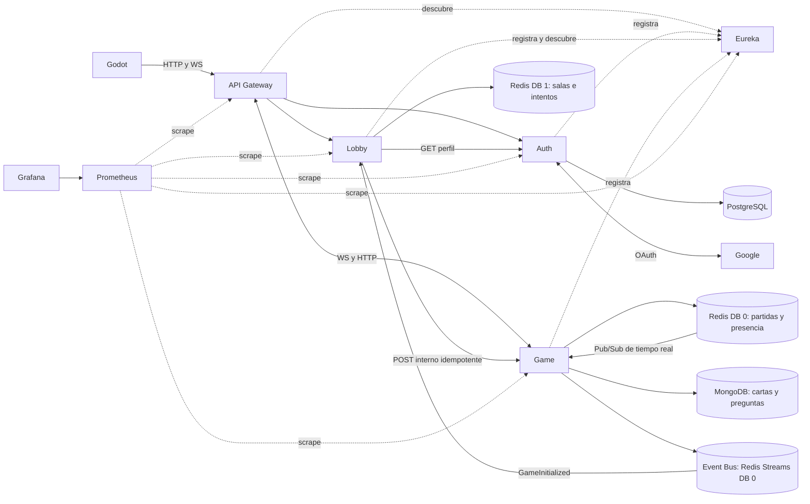

# Arquitectura del segundo corte

Redis DB 0 y DB 1 comparten servidor, memoria y durabilidad. Los servicios no leen el estado privado del otro: Lobby accede al stream de integración de DB 0, no a los snapshots de Game.

| Contexto y lenguaje | Núcleo y fronteras | Casos de uso, puertos y adaptadores |
|---|---|---|
| **Game:** partida, jugador, ficha, asiento, dado, turno, desafío, efecto, movimiento legal | `GameState` es la raíz. `Player` y `Piece` se identifican dentro de la partida. `GameSetup.Participant`, `RuleEngine.Move` y `CardChoice` representan datos de valor. `Board`, `RuleEngine`, `TriviaRules`, `CardRules`, `DiceRules`, `TurnManager`, `TurnOrder` y `BotPolicy` conservan las reglas. | REST y WS mapean DTO `CreateGame` y `Action` a `GameSetup` y `GameAction`. `GameService` es el puerto de entrada concreto: creación, acción, consulta, reconexión y mantenimiento. `GameRepository`, `ActiveGames`, `GameCatalog`, `DiceSource`, `Presence` y `PayloadFingerprints` son puertos salientes. Redis, Mongo, reloj, aleatoriedad y Jackson se ensamblan en adaptadores. |
| **Lobby:** sala, anfitrión, creador, participante, listo, voto, inicio, intento | `Lobby` y sus `Player` forman el agregado; `GameInitialization` y `Seat` son valores inmutables. El plan conserva orden, mapa y asientos. Redis/Lua sigue aplicando los permisos, cupos y condiciones de preparación sobre los datos vigentes. | FastAPI → `LobbyService` / `StartGame` → protocolos `LobbyStore`, `StartStore`, `PlayerNames`, `GameCreation`. `LobbyStore` no hereda del puerto de inicio. El consumidor recibe únicamente `ConfirmStart`. `LobbyRepository`, `AuthClient`, `GameClient`, consumidor y tareas de recuperación son adaptadores. |
| **Identity:** usuario local, perfil, nombre, refresh, revocación | `User` y `RefreshToken` conservan su identidad y mapeo JPA. `DisplayName` valida únicamente ediciones manuales. `RefreshValidity` conserva vigencia y duración. | `AuthService`, `UserService`, `RefreshTokenService` coordinan renovación, revocación y perfil. `AccessTokenIssuer` abstrae al firmador `JwtService`. Controladores, OAuth, filtros y JPA permanecen en el mismo módulo. `UserAccounts` desacopla los casos de perfil e identidad del repositorio Spring Data. Se conserva la entidad JPA y el repositorio de refresh. |

**Invariantes.** Game verifica pertenencia, turno y dados del servidor. La confirmación escribe la partida, sus recibos e índice con CAS. Creador o anfitrión de reemplazo inicia; se rota por asiento en sentido horario, se conservan dobles y retirada. Humanos y bots ejecutan las mismas reglas. Lobby permite 2–4 participantes, aplica preparación y permisos bajo Lua, y no cambia la sala de espera después de reservar el inicio. Auth conserva unicidad JPA, sesión OAuth y vigencia de tokens.

**Sentido de las dependencias.** El motor no importa DTO de transporte, Spring, Redis, Mongo ni WebSocket. El agregado de Lobby y su política de selección no importan FastAPI ni Redis. Los adaptadores conocen los puertos. `GameUpdate` y `GameSnapshot` son resultados de aplicación; Redis serializa y el adaptador REST mapea la vista pública. Las huellas siguen siendo SHA-256 sobre la representación previa, comprobada por `CommandCompatibilityTest`. El esquema persistido de Game mantiene campos y lectura de snapshots antiguos.

**Persistencia.** JPA/Hibernate se usa en PostgreSQL. MongoTemplate y documentos Spring Data son el adaptador apropiado para MongoDB; Redis usa tipos nativos, scripts y Streams. JPA estándar no modela estas operaciones de Redis ni documentos Mongo. Si el texto de la rúbrica exige JPA también para NoSQL, aclarar con el profesor; se demuestra persistencia NoSQL con los adaptadores nativos. No se duplican almacenes para consultas ni se usa Event Sourcing.

**Observabilidad.** Actuator + Micrometer en Java/Kotlin; cliente Prometheus en FastAPI. El dashboard provisionado muestra targets, tráfico, latencia, errores, eventos, reintentos e intentos pendientes. Las etiquetas son rutas parametrizadas y resultados finitos. No incluyen IDs de partida, usuario ni tokens.
