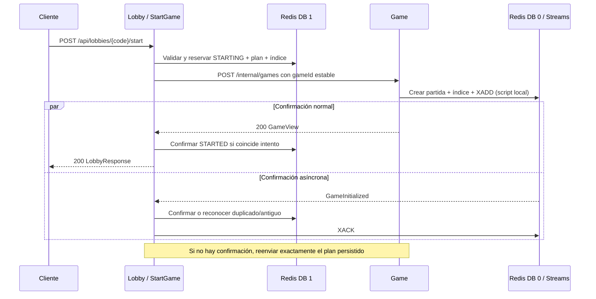

# SAGA de inicio y contrato EDA

Lobby orquesta la operación porque ya posee el permiso de inicio y el contrato síncrono. Game conserva su endpoint privado `POST /internal/games` y su fuente de verdad. La confirmación por HTTP acelera el caso normal; el evento persistente puede completar la misma transición sin depender de esa respuesta.



| Estado | Entrada | Transición |
|---|---|---|
| `WAITING` | Start autorizado, cupo y preparación | Lua verifica versión y generación de la sala y almacena plan y vencimiento de reintento antes del primer envío. Cambia a `STARTING`. |
| `STARTING/PENDING` | HTTP 200 válido o `GameInitialized` correlacionado | Lua compara intento y mapa, cambia a `STARTED`, retira índice y renueva TTL. |
| `STARTING/PENDING` | Rechazo anterior a la creación en el único envío registrado | Compensación local a `WAITING`. No se borran partidas. |
| `STARTING/PENDING` | Timeout, desconexión, cierre de Lobby, fallo de Redis al confirmar | Conservar el plan. Al quedar vencida la reserva de despacho, otro trabajador puede reclamarla y repetir el mismo `gameId`. |
| `STARTING/MANUAL` | Siete despachos reservados sin confirmación | No volver a enviar automáticamente. Registrar diagnóstico. Todavía puede finalizar por confirmación correlacionada mientras exista la sala. |
| `STARTED` | Repetición del evento o confirmación HTTP | Mismo ID y mapa: duplicado, sin incrementar versión. Si no coincide: ignorar. |

El `gameId` sirve también como correlación. Redis conserva el plan completo y el contador. Una reserva de 30 segundos excluye otros trabajadores; la llamada HTTP se acota a 10 segundos. El recuperador consulta el índice cada dos segundos. Lobby mantiene `STARTING` ante resultados ambiguos (corrección del fallo anterior), sin introducir nuevos estados públicos ni cambiar 200, 502, 503 o 409 del contrato. El bloqueo por intento no convierte un timeout en un rechazo definitivo. La expiración normal de la sala sigue aplicando; se garantiza un mínimo de 300 segundos para las claves no vencidas al reservar. El estado manual no constituye retención indefinida. El operador debe revisar el intento y la partida por su ID antes de expirar la sala; no debe forzar otro ID o borrar partidas. Un `STARTING` histórico sin plan no se reconstruye automáticamente.

La creación en Game no sobrescribe snapshots, reinicia temporizadores ni repite el evento si el ID y la huella ya existen. El índice, la partida y el registro del evento se escriben en el mismo script Redis, que comprueba el tipo del índice antes de escribir. Los permisos Redis, tipos de claves y capacidad deben estar bien configurados; la ejecución indivisible de Lua no equivale a rollback de errores arbitrarios.

## Contrato Redis Streams v1

Stream por defecto: `pixelchiss:game:integration`, DB 0, campo `event` con JSON UTF-8. Productor Game. Grupo consumidor `lobby-game-initialization-v1` en Lobby. Ejemplo ilustrativo:

```json
{
  "eventId": "game-initialized:game-ABCDEF-01234567",
  "eventType": "GameInitialized",
  "schemaVersion": 1,
  "timestamp": "2026-11-10T22:00:00Z",
  "producer": "game-service",
  "correlationId": "game-ABCDEF-01234567",
  "gameId": "game-ABCDEF-01234567",
  "payload": {"lobbyId": "ABCDEF", "mapId": "classic"}
}
```

El consumidor lee con `XREADGROUP`, recupera pendientes con `XAUTOCLAIM` a partir de 5 s y confirma después de aplicar el efecto idempotente. Un contrato inválido o un efecto fallido cinco veces se registra en `:failed` con el ID de origen y un motivo, y se confirma después. Una caída entre ambas escrituras puede duplicar el registro fallido, no el efecto. Retención aproximada: 10 000 eventos y 1 000 fallidos. Si se recorta un evento antes de consumirlo, la recuperación por el mismo comando HTTP sigue disponible dentro de su ventana. No hay garantía de exactamente una vez. No se transportan credenciales, respuestas de trivia ni snapshots.

Pub/Sub continúa difundiendo estados a todas las instancias que atienden WebSocket. No se usa Streams para cada movimiento; los clientes recuperan el snapshot con `SYNC_REQUEST`. Los detalles de rutas y mensajes siguen en [línea base](baseline.md) y [WebSocket](../../game-service/docs/WEBSOCKET.md).
