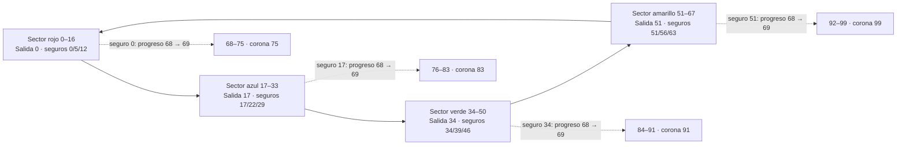

# Tablero v3-100

El dominio implementa exactamente **100 casillas físicas**: 68 comunes (`0–67`) y 32 finales (`68–99`). Hay cuatro sectores de 17 y cuatro corredores privados de ocho, incluida la corona. Ambos mapas, `classic` y `science`, usan la misma geometría, con 2–4 jugadores y cuatro fichas por jugador. Las casas no son casillas.

La regla confirmada por el equipo de Godot exige completar la vuelta y volver al **mismo seguro de salida del propio color** antes de entrar al corredor. El seguro es una única casilla física, visitada al liberar (`progress=0`) y al completar la vuelta (`progress=68`). El siguiente paso (`progress=69`) entra al corredor propio. No se añaden posiciones ni se duplica el seguro en `cells` o en el conjunto de seguros. El cliente Godot real aún no se ha ejecutado.

## Sectores, salidas, seguros, trivia y corredores

| Asiento / color | Sector común | Salida de las cuatro fichas | Seguros | Trivia | Orden común completo | Seguro de acceso → primer final | Corredor en orden | Corona |
|---|---|---:|---|---:|---|---|---|---:|
| 0 / RED, rojo | 0–16 | 0 | 0, 5, 12 | 8 | 0…67, 0 | 0 → 68 | 68 → 69 → 70 → 71 → 72 → 73 → 74 → 75 | 75 |
| 1 / BLUE, azul | 17–33 | 17 | 17, 22, 29 | 25 | 17…67, 0…17 | 17 → 76 | 76 → 77 → 78 → 79 → 80 → 81 → 82 → 83 | 83 |
| 2 / GREEN, verde | 34–50 | 34 | 34, 39, 46 | 42 | 34…67, 0…34 | 34 → 84 | 84 → 85 → 86 → 87 → 88 → 89 → 90 → 91 | 91 |
| 3 / YELLOW, amarillo | 51–67 | 51 | 51, 56, 63 | 59 | 51…67, 0…51 | 51 → 92 | 92 → 93 → 94 → 95 → 96 → 97 → 98 → 99 | 99 |

Seguros obligatorios: **0, 5, 12, 17, 22, 29, 34, 39, 46, 51, 56, 63**. El índice 16 es ordinario. Cada seguro admite dos fichas, incluso de colores distintos, y protege de captura ordinaria. Las cartas `kill-next` y `kill-chosen` ignoran esa protección en comunes, incluidas salidas.

La trivia conserva una casilla por sector al desplazamiento relativo ocho del modelo anterior: `17*sector + 8`, es decir, **8, 25, 42, 59**. Es una regla de traslado, no cuatro posiciones adicionales. No se modifican las 16 preguntas por mapa ni las seis cartas.

Este diagrama muestra enlaces lógicos y numeración; no sustituye el plano visual de Godot:



## HOME y salidas

`Piece.home()` conserva exactamente esta representación, tanto al crear fichas como tras captura, carta, penalización o retirada:

```json
{"id":"seat-0-piece-0","ownerId":"a","number":0,"status":"HOME","position":null,"progress":-1}
```

Godot dibuja las casas por estado y propietario. No existe índice de cárcel, posición compartida HOME ni coordenada fuera de `0–99`.

Cada dado de una tirada con dobles puede liberar una ficha, consumiendo ese dado sin avance adicional. `legalMoves[].from` es `null`. Las cuatro fichas de cada color comparten la salida común de su asiento y conservan sus IDs individuales. La salida es un seguro de capacidad dos; una tercera liberación exige liberar cupo, y las fichas rivales también cuentan. El segundo dado puede avanzar una ficha o liberar otra. No se liberan las cuatro automáticamente.

```json
{"pieceId":"seat-0-piece-0","dieIndex":0,"dieValue":4,"from":null,"to":0,"progress":0,"capture":false,"safe":true,"crown":false,"release":true}
```

Después de ejecutar esa opción:

```json
{"id":"seat-0-piece-0","ownerId":"a","number":0,"status":"BOARD","position":0,"progress":0}
```

## Fórmulas y ocupación

Para asiento `s=0..3`, ficha `n=0..3` y progreso relativo `p`:

| Progreso | Estado y posición física |
|---|---|
| -1 | `HOME`, posición `null`; no se llama a `Board.position` |
| 0–68 | `BOARD`, `(17*s + p) mod 68`; 0 es salida y 68 regreso al mismo seguro |
| 69–75 | `BOARD`, `68 + 8*s + (p-69)` |
| 76 | `CROWNED`, `75 + 8*s` |

La liberación establece `p=0`; un avance posterior usa `p'=p+dieValue`. El número de ficha distingue identidad, no ruta física. Cada una de las 16 rutas REST contiene **77 entradas ordenadas y 76 IDs físicos distintos**: 69 visitas a comunes (68 únicas, porque salida y acceso son el mismo seguro) y ocho finales únicas. El índice del array de ruta coincide con `progress`. Las 100 casillas físicas de `cells` siguen siendo únicas. El retorno al seguro cuesta el paso normal desde su predecesora; entrar al corredor cuesta otro paso, sin una visita adicional artificial. No entra en corredores ajenos. Coincidencia y captura se calculan por posición física, no por progreso.

Comunes ordinarias admiten una ficha: una propia bloquea el destino y una rival vuelve a HOME antes de colocar la atacante (`PIECE_CAPTURED`). Los seguros admiten dos. Cada una de las siete casillas finales intermedias es privada, protegida y de capacidad uno. Cada corona admite las cuatro fichas coronadas propias, excluidas de ocupación ordinaria. Se valida el destino; se conserva la regla sin barreras intermedias.

## Coronación, turnos, victoria y retirada

Se exige número exacto: en `p=75`, 1 corona y 2 produce `OVERSHOOT`; en `p=74`, 2 corona y 3 produce `OVERSHOOT`. La ficha coronada rechaza movimientos con `CROWNED_PIECE`. La cuarta coronación declara `FINISHED` y un único ganador en la misma actualización. No hay rebote ni truncamiento del dado.

El creador indicado por Lobby abre el turno. Después se siguen asientos horarios `0→1→2→3`, omitiendo ausentes y retirados; dobles dan turno adicional al consumir o descartar automáticamente los dados. Timeout y `END_TURN` renuncian a ese premio. Reconectar no cambia asientos ni turno. Lobby asigna `[0,2]` a dos jugadores, `[0,1,2]` a tres y `[0,1,2,3]` a cuatro.

La retirada devuelve todas las fichas, incluso coronadas, mediante `home()` y elimina efectos. Con menos de dos activos termina `ABANDONED`, sin declarar victoria por retirada.

## Contrato y actualización

`GET /api/game/board` conserva campos `layout`, `cellCount`, `safe`, `trivia`, `cells` y `routes`, ahora con `layout="v3-100"`. Las casillas son `TRACK`, `FINISH_LANE` o `CROWN`; desaparece el tipo físico `EXIT`. Las rutas por asiento siguen conteniendo cuatro listas, ahora iguales entre fichas del mismo asiento. REST, WebSocket, autenticación, DTOs, eventos y contratos SAGA/EDA se conservan salvo el significado necesario de posiciones y progreso.

Es incompatible reutilizar coordenadas del layout anterior: desaparecen las salidas físicas independientes y los finales cambian. El agregado persistido tiene `boardLayout="v3-100"`; estados sin versión, con `v1`, con el borrador `v2-100` o desconocidos se rechazan con `UNSUPPORTED_BOARD_LAYOUT` antes de recuperar recibos, reconectar o mutar. No se borran claves ni se convierten índices automáticamente. Procedimiento en [GUIA_ACTUALIZACION.md](../../docs/GUIA_ACTUALIZACION.md#tablero-de-100-casillas).

Godot debe actualizar su mapa de coordenadas, eliminar salidas físicas independientes, interpretar HOME por estado y consumir las rutas del servidor. El enlace salida→vuelta→seguro→corredor sigue la regla confirmada por Godot; la ejecución del cliente real continúa pendiente y no se afirma compatibilidad visual completa.

## Transición de vuelta completa

| Asiento | Fin de la vuelta y entrada (IDs físicos en orden) | Primera final | Corona |
|---|---|---:|---:|
| Rojo / 0 | 65 → 66 → 67 → **0** → 68 → 69 | 68 | 75 |
| Azul / 1 | 14 → 15 → 16 → **17** → 76 → 77 | 76 | 83 |
| Verde / 2 | 31 → 32 → 33 → **34** → 84 → 85 | 84 | 91 |
| Amarillo / 3 | 48 → 49 → 50 → **51** → 92 → 93 | 92 | 99 |

En todos los asientos, esos IDs corresponden a progresos 65, 66, 67, **68**, 69 y 70. Se puede cruzar el seguro y entrar al corredor en una sola acción si el dado cubre esa distancia. Por ejemplo, rojo en 67 (`p=67`) con 1 llega a 0 (`p=68`); con 2 llega a 68 (`p=69`), la primera final. La capacidad se comprueba en el destino; cruzar un seguro lleno sin detenerse conserva la regla existente de ausencia de barreras intermedias.

La corrección de `v2-100` a `v3-100` desplaza en uno los progresos finales: primera final 68→69 y corona 75→76. Las coordenadas físicas finales no cambian. Un borrador persistido v2-100 se rechaza explícitamente, porque interpretar su progreso con esta ruta cambiaría el significado de sus fichas; no se retoca ni se reproduce su recibo.
